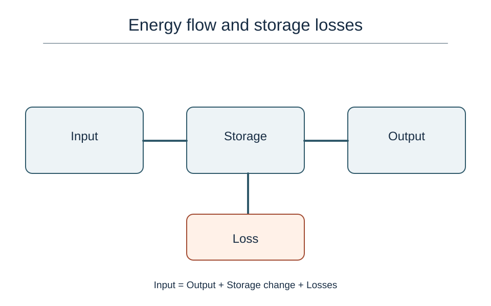

# M1-L1 – Energy, Power and Efficiency {#L1}

**Course area:** M1 – System Quantities and Power Balances  
**Level:** Bachelor · Foundations  
**Prerequisites:** Basic electrical quantities and introductory mathematics.  
**Learning objective:** calculate a storage balance, convert power to energy and determine round-trip efficiency.

## Motivating problem {#S1}

A pumped-storage plant consumes electric power while pumping and delivers electric power while generating. The grid must balance both operating modes against all other injections and withdrawals. Distinguish **power** (instantaneous rate), **energy** (accumulated transfer) and **efficiency** (useful output divided by input) before analysing the system.

## Concepts, Model and Derivation {#S2}

A system boundary separates the device from its environment. Choose power entering the system as positive. At steady state with no energy accumulation, $P_\mathrm{in}=P_\mathrm{out}+P_\mathrm{loss}$. For storage, the balance becomes $\mathrm dE_\mathrm{store}/\mathrm dt=P_\mathrm{in}-P_\mathrm{out}-P_\mathrm{loss}$.

For a DC circuit or a suitable single-phase example, real power is $P=UI$. AC systems require RMS quantities and a power factor. Energy follows $E=\int_{t_0}^{t_1}P(t)\,\mathrm dt$ or, for constant power, $E=P\Delta t$. Because $1\,\mathrm{kW}\cdot1\,\mathrm h=1\,\mathrm{kWh}$, one kilowatt-hour equals $3.6\,\mathrm{MJ}$. Define efficiency using a specified interval and boundary: $\eta=E_\mathrm{useful}/E_\mathrm{in}$. Ratios of constant powers give the same result when their intervals match.

## Worked Example {#S3}

An illustrative storage device charges at $5\,\mathrm{kW}$ for two hours, then delivers $8\,\mathrm{kWh}$ back to the grid. Input energy is $E_\mathrm{in}=5\cdot2=10\,\mathrm{kWh}$. Round-trip efficiency is $\eta_\mathrm{rt}=8/10=0.80=80\,\%$. The $2\,\mathrm{kWh}$ difference is unrecovered energy within the defined cycle boundary, not a measured performance claim for a particular battery.

## Self-Check {#S4}

### Exercises

1. A load draws 1.5 kW for 40 minutes. Calculate energy in kWh and MJ. Why does this not indicate its maximum instantaneous grid demand?
2. A hypothetical process takes in 12 kWh and delivers 9 kWh of useful energy. Find efficiency and energy loss.

::: {.lc-solutions data-lc-section="S4"}
1. $40\,\mathrm{min}=2/3\,\mathrm h$, so $E=1.5(2/3)=1.0\,\mathrm{kWh}=3.6\,\mathrm{MJ}$. The total says nothing about peak demand or inrush current.
2. 75%; 3 kWh within the chosen balance boundary.
:::

## Assumptions, Safety and Limits {#S5}

The example neglects temperature variation, degradation and changing auxiliary losses. Losses represent energy transferred to the environment. Three-phase AC power requires a separate model.

## Summary and Next Steps {#S6}

Power measures energy flow per unit time, while energy is its integral. Explicit system boundaries and consistent time horizons matter; the next lesson examines variable loads.

**Continue:** [M1-L2 – Time Series, Load Profiles and Coincidence](M1-L2.md).

## Sources (external) {#S7}

- [KIT, Elektrotechnisches Institut – Vertiefungsrichtung Elektrische Energietechnik](https://www.eti.kit.edu/730.php) · Bachelor/Master specialisation overview and study plan; generation, transmission, storage, drives and control · Last accessed: 2026-11-23
- [Universität Stuttgart, Fakultät 5 – Electrical Power Systems](https://www.f05.uni-stuttgart.de/ei/studiengaenge/eeng/uebersicht/Electrical-Power-Systems/) · Electrical Power Systems degree specialisation; generation, distribution, sustainable and reliable networks · Last accessed: 2026-11-23
