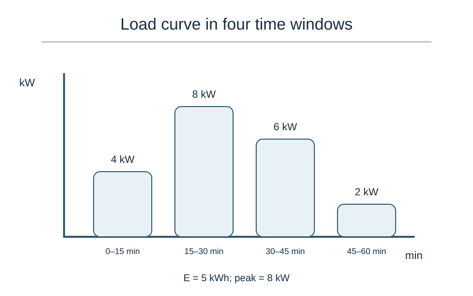

# M1-L2 – Time Series, Load Profiles and Coincidence {#L2}

**Course area:** M1 – System Quantities and Power Balances  
**Level:** Bachelor · Foundations  
**Prerequisites:** Basic electrical quantities and introductory mathematics.  
**Learning objective:** integrate a load profile, distinguish average and peak power, and assess coincidence.

## Motivating problem {#S1}

A grid is not sized only for the total energy consumed during a day. Lines and equipment must withstand coincident peak power. A **load curve** is a time-ordered sequence of power observations; integrating it gives energy. The observation interval matters.

## Concepts, Model and Derivation {#S2}

For regularly sampled mean powers, $E\approx\sum_{k=1}^{n}P_k\Delta t$. Average load is $\overline P=E/T$, peak load is $P_\mathrm{max}=\max_k P_k$, and the load factor $LF=\overline P/P_\mathrm{max}$ ranges from zero to one for nonnegative loads. It must not be confused with the AC power factor $\cos\varphi$.

**Coincidence** matters: different users may peak at different times. The peak of their sum cannot exceed the sum of their individual peaks, and it may be much smaller. Hourly averages do not faithfully capture second-scale transients. A signed net injection profile requires an explicit sign convention.

## Worked Example {#S3}

Four 15-minute average loads are $4$, $8$, $6$ and $2\,\mathrm{kW}$. Energy is $(4+8+6+2)0.25=5\,\mathrm{kWh}$. Average load over one hour is $5\,\mathrm{kW}$, 15-minute peak is $8\,\mathrm{kW}$ and load factor is $5/8=0.625$. These values are not a substitute for a thermal network design calculation.

## Self-Check {#S4}

### Exercises

1. Customer A draws 3 kW then 1 kW in two successive hours; customer B draws 1 kW then 3 kW. What is the combined peak compared with the sum of individual peaks?
2. Three intervals of 15, 30 and 15 min have 2, 6 and 4 kW. Find energy, mean and peak interval-average power.

::: {.lc-solutions data-lc-section="S4"}
1. Combined demand is 4 kW in both hours, so combined peak equals 4 kW. Adding the two individual maxima would give 6 kW; this illustrates noncoincident peaks.
2. 0.5+3+1=4.5 kWh; 4.5 kW; 6 kW.
:::

## Assumptions, Safety and Limits {#S5}

Forecasts require representative measurements, seasonality and uncertainty estimates. Sampling intervals alter observed peaks, so these examples do not establish permitted connection ratings.

## Summary and Next Steps {#S6}

A load profile links power and energy at a chosen time resolution. Peak values depend on the measurement interval; next come AC power quantities.

**Continue:** [M1-L3 – Three-Phase Power and Power Factor](M1-L3.md).

## Sources (external) {#S7}

- [KIT, Institut für Elektroenergiesysteme und Hochspannungstechnik – Elektrische Energienetze](https://www.ieh.kit.edu/2448_bee.php) · EEN lecture contents (winter semester), sections 1–5; three-phase power, power flow, networks and faults · Last accessed: 2026-11-23
- [Universität Stuttgart, Fakultät 5 – Electrical Power Systems](https://www.f05.uni-stuttgart.de/ei/studiengaenge/eeng/uebersicht/Electrical-Power-Systems/) · Electrical Power Systems degree specialisation; generation, distribution, sustainable and reliable networks · Last accessed: 2026-11-23
