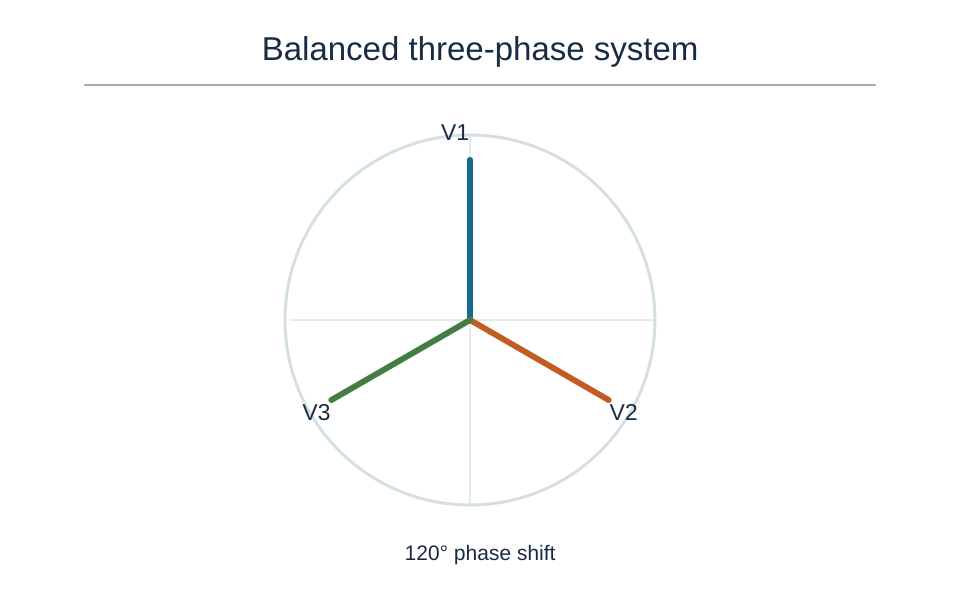

# M1-L3 – Three-Phase Power and Power Factor {#L3}

**Course area:** M1 – System Quantities and Power Balances  
**Level:** Bachelor · Foundations  
**Prerequisites:** Basic electrical quantities and introductory mathematics.  
**Learning objective:** calculate total powers in balanced sinusoidal three-phase systems and interpret reactive power.

## Motivating problem {#S1}

Power grids frequently use three-phase AC. Under balanced conditions the three phase voltages are separated by 120 electrical degrees. Always distinguish line-to-line voltage from phase-to-neutral voltage before applying a formula.

## Concepts, Model and Derivation {#S2}

For a balanced sinusoidal wye system, $U_\mathrm{LL}=\sqrt3\,U_\mathrm{ph}$ in RMS quantities. Line current equals phase current. Total apparent power is $S=\sqrt3\,U_\mathrm{LL}I_\mathrm L$. Real and reactive powers are $P=\sqrt3\,U_\mathrm{LL}I_\mathrm L\cos\varphi$ and $Q=\sqrt3\,U_\mathrm{LL}I_\mathrm L\sin\varphi$. For balanced sinusoidal conditions, $S^2=P^2+Q^2$.

Real power $P$ (watts) represents average energy transfer. Reactive power $Q$ (var) accounts for reversible energy exchange with electric and magnetic fields. Under ideal sinusoidal conditions, $\cos\varphi$ is the displacement factor between phase voltage and current. With harmonics, it is not generally identical to the overall power factor $P/S$.

## Worked Example {#S3}

An **illustrative** balanced load has $U_\mathrm{LL}=400\,\mathrm V$, $I_\mathrm L=10\,\mathrm A$ and lagging $\cos\varphi=0.9$. Then $S=\sqrt3(400)(10)\approx6.93\,\mathrm{kVA}$ and $P\approx6.24\,\mathrm{kW}$. As $\sin\varphi=\sqrt{1-0.9^2}\approx0.436$, reactive power is $Q\approx3.02\,\mathrm{kvar}$. These are numerical examples, not connection requirements.

## Self-Check {#S4}

### Exercises

1. Compute real power for a balanced sinusoidal load with 400 V line-to-line voltage, 5 A line current and unity power factor. Why does this formula fail for unbalanced loads?
2. A balanced sinusoidal load requires 8 kW at an inductive power factor of 0.8. Find S and Q.

::: {.lc-solutions data-lc-section="S4"}
1. $P=\sqrt3(400)(5)=3.46\,\mathrm{kW}$. Unbalanced systems require individual phase powers to be summed; the compact expression assumes equal phase quantities.
2. S=10 kVA; Q=6 kvar, positive under the load convention.
:::

## Assumptions, Safety and Limits {#S5}

Three-phase electrical installations present lethal hazards. Do not attempt live wiring or measurements; all examples are calculation or simulation exercises.

## Summary and Next Steps {#S6}

Line-to-line voltage, line current and phase angle determine P, Q and |S| in the balanced model. These quantities underpin grid equipment and line models.

**Continue:** [M2-L1 – Voltage Levels, Topologies and Supply Paths](M2-L1.md).

## Sources (external) {#S7}

- [KIT, Institut für Elektroenergiesysteme und Hochspannungstechnik – Elektrische Energienetze](https://www.ieh.kit.edu/2448_bee.php) · EEN lecture contents (winter semester), sections 1–5; three-phase power, power flow, networks and faults · Last accessed: 2026-11-23
- [KIT, Elektrotechnisches Institut – Vertiefungsrichtung Elektrische Energietechnik](https://www.eti.kit.edu/730.php) · Bachelor/Master specialisation overview and study plan; generation, transmission, storage, drives and control · Last accessed: 2026-11-23
