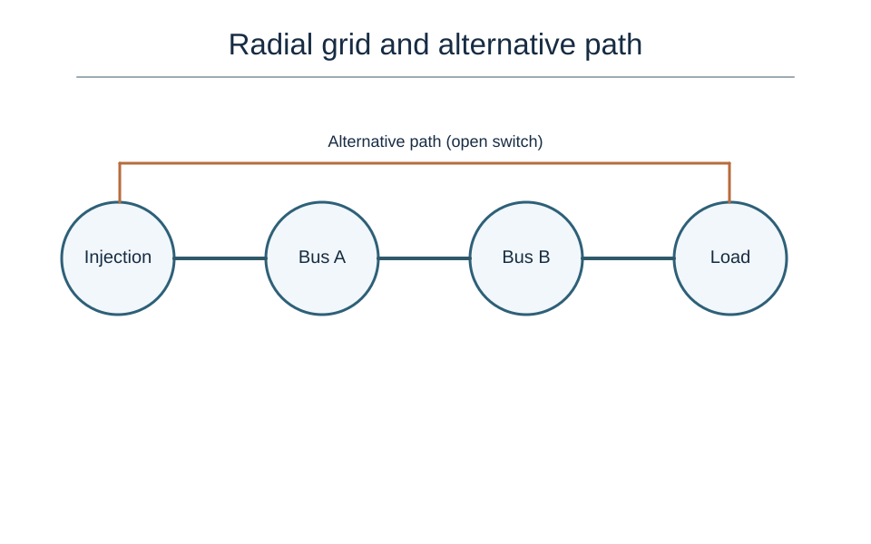

# M2-L1 – Voltage Levels, Topologies and Supply Paths {#L1}

**Course area:** M2 – Grid Structures and Equipment  
**Level:** Bachelor · Foundations  
**Prerequisites:** Basic electrical quantities and introductory mathematics.  
**Learning objective:** distinguish radial, ring and meshed grids as graphs and identify possible outage paths.

## Motivating problem {#S1}

A grid diagram is not merely a map: it specifies electrical connectivity and possible alternatives when an element is lost. A **radial feeder** initially offers one path from its supply point to each downstream load. Ring and meshed structures may create alternatives, but require suitable protection and operation.

## Concepts, Model and Derivation {#S2}

A graph represents buses as vertices and lines or transformers as edges. Connectivity alone does not determine current; impedances, injections and voltages are also needed. Breaking a radial edge can disconnect downstream consumers, whereas a mesh may redirect power to remaining paths.

Different voltage levels perform different tasks in generation, transmission and distribution. A schematic supply chain connects generation, transmission, transformation, distribution and consumption. **Actual connection and voltage limits** depend on the country, voltage level, network operator and currently applicable requirements; they cannot be inferred from a generic diagram.

## Worked Example {#S3}

In radial path A–B–C, B consumes 2 MW and C 1 MW. Neglecting losses and with all supply at A, line A–B transfers 3 MW while B–C transfers 1 MW. If A–B opens, both loads are disconnected unless an alternative route is provided. Adding a switchable link A–C offers another path, but its capacity must be checked.

## Self-Check {#S4}

### Exercises

1. A grid has edges A–B, B–C and C–D. What changes if an A–D link is added and B–C fails? Why is a schematic not enough to permit operation?
2. A lossless radial path A–B–C–D has loads of 1, 2 and 3 MW at B, C, D. Find branch flows.

::: {.lc-solutions data-lc-section="S4"}
1. A second path to D becomes available via A–D. Thermal ratings, voltages and protection coordination still have to be demonstrated.
2. 6, 5 and 3 MW towards D. No conclusion about permitted loading.
:::

## Assumptions, Safety and Limits {#S5}

Diagrams describe analytical topology, not switching instructions. Any actual work on electrical networks requires authorised qualified personnel.

Regulatory scope **Germany, low voltage, web status checked 23 November 2026**: VDE FNN distinguishes the technical connection rules for customer installations (VDE-AR-N 4100:2026-04) from those for generating installations (VDE-AR-N 4105:2026-03). The respective network operator also publishes supplementary technical connection conditions (TAB). The linked webpages establish the scope of these rules; the simplified diagram does not demonstrate installation compliance.

## Summary and Next Steps {#S6}

Topology determines possible supply paths, not their electrical loading capacity. Next, lines and transformers acquire physical models.

**Continue:** [M2-L2 – Line Models, Losses and Transformers](M2-L2.md).

## Sources (external) {#S7}

- [KIT, Institut für Elektroenergiesysteme und Hochspannungstechnik – Elektrische Energienetze](https://www.ieh.kit.edu/2448_bee.php) · EEN lecture contents (winter semester), sections 1–5; three-phase power, power flow, networks and faults · Last accessed: 2026-11-23
- [KIT, Elektrotechnisches Institut – Vertiefungsrichtung Elektrische Energietechnik](https://www.eti.kit.edu/730.php) · Bachelor/Master specialisation overview and study plan; generation, transmission, storage, drives and control · Last accessed: 2026-11-23
- [VDE FNN – Low-voltage connection rules, VDE-AR-N 4100:2026-04](https://www.vde.com/de/fnn/themen/tar/tar-niederspannung/tar-niederspannung-vde-ar-n-4100) · Customer installations on German low-voltage networks; public overview, not full standard text · Web view checked: 2026-11-23
- [VDE FNN – Low-voltage generation rules, VDE-AR-N 4105:2026-03](https://www.vde.com/de/fnn/themen/tar/tar-niederspannung/erzeugungsanlagen-am-niederspannungsnetz-vde-ar-n-4105-2018) · Generation facilities, protection, operation and verification; public overview, not full standard text · Web view checked: 2026-11-23
