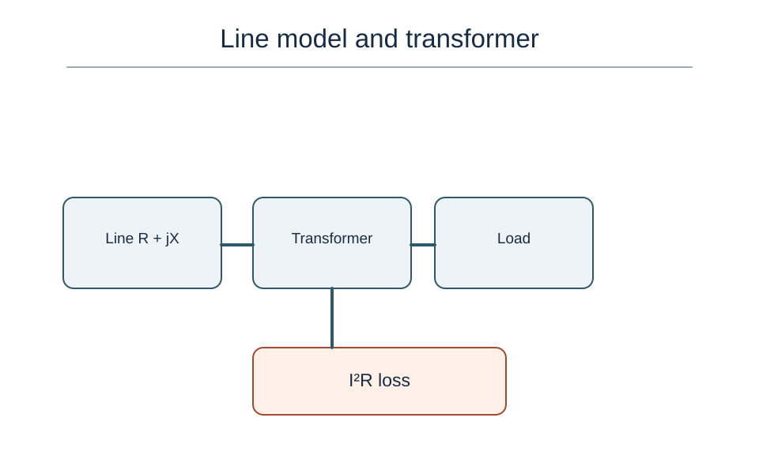

# M2-L2 – Line Models, Losses and Transformers {#L2}

**Course area:** M2 – Grid Structures and Equipment  
**Level:** Bachelor · Foundations  
**Prerequisites:** Basic electrical quantities and introductory mathematics.  
**Learning objective:** calculate three-phase resistive losses and ideal transformer ratios with explicit assumptions.

## Motivating problem {#S1}

Losses in transmission and distribution depend on current, conductor resistance and operating state. Equivalent circuits approximate lines with resistance, reactance and, for longer routes, capacitive effects. Transformers change voltage levels but do not generate energy.

## Concepts, Model and Derivation {#S2}

For one simplified phase conductor of resistance $R$, resistive loss is $P_\mathrm{loss}=I^2R$. For three equal phases, $P_{\mathrm{loss},3}=3I^2R$. A phasor line model may use series impedance $Z=R+\mathrm jX$; voltage drop depends on current magnitude and angle.

An ideal transformer satisfies $U_1/U_2=N_1/N_2=a$ and, in a simplified power-transfer model, current magnitudes approximately satisfy $I_1/I_2=1/a$. Real transformers also have winding losses, core losses and leakage impedance. The ideal device is a first approximation, not a device specification.

## Worked Example {#S3}

A **hypothetical** balanced three-phase line has $R=0.40\,\Omega$ per phase and current $I=100\,\mathrm A$. Resistive loss is $3(100)^2(0.40)=12\,000\,\mathrm W=12\,\mathrm{kW}$. Doubling current at the same resistance raises loss to $48\,\mathrm{kW}$, four times as much. Voltage cannot simply be increased without considering insulation and equipment constraints.

## Self-Check {#S4}

### Exercises

1. An ideal single-phase transformer has a voltage ratio of 10 kV to 1 kV. Given a primary current of 20 A, find the secondary current and apparent-power magnitude. What would the total apparent power of a balanced three-phase system be at the same line-to-line voltages and line currents, assuming the corresponding ideal line voltage/current ratios are specified?
2. A balanced three-phase line has 0.2 ohms per phase. Compare resistive losses at 50 and 150 A.

::: {.lc-solutions data-lc-section="S4"}
1. $I_2=10\cdot20=200\,\mathrm A$. Single-phase: $|S|=10\,\mathrm{kV}\cdot20\,\mathrm A=200\,\mathrm{kVA}$. Balanced three-phase, using line quantities: $|S|=\sqrt3\cdot10\,\mathrm{kV}\cdot20\,\mathrm A\approx346.41\,\mathrm{kVA}$. These are apparent-power magnitudes, not guaranteed active power or rated power.
2. 3×0.2×50²=1500 W; 13,500 W; factor 9.
:::

## Assumptions, Safety and Limits {#S5}

The simplified model omits capacitance, skin effects, temperature and fault behaviour. High-voltage systems are dangerous; no live testing or actual protection sizing is implied.

## Summary and Next Steps {#S6}

Line resistance causes I²R losses; transformers link voltages and currents through turns ratio. Voltage control also requires reactive power.

**Continue:** [M2-L3 – Voltage Control and Reactive Power Flows](M2-L3.md).

## Sources (external) {#S7}

- [KIT, Institut für Elektroenergiesysteme und Hochspannungstechnik – Elektrische Energienetze](https://www.ieh.kit.edu/2448_bee.php) · EEN lecture contents (winter semester), sections 1–5; three-phase power, power flow, networks and faults · Last accessed: 2026-11-23
- [TU Dresden, Fakultät Elektrotechnik und Informationstechnik – Wahlpflichtmodule ET, MT, IST, RES](https://tu-dresden.de/ing/elektrotechnik/studium/im_studium/lehrangebot/wahlpflichtmodule) · Planning of Electrical Power Systems / Fundamentals of Electrical Power Systems / Controlled Power Systems; network planning, calculations, equipment and control · Last accessed: 2026-11-23
