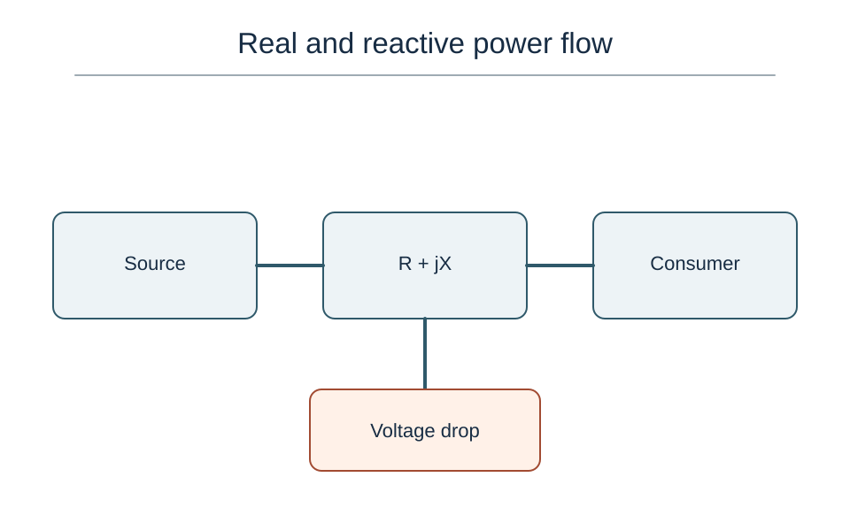

# M2-L3 – Voltage Control and Reactive Power Flows {#L3}

**Course area:** M2 – Grid Structures and Equipment  
**Level:** Bachelor · Foundations  
**Prerequisites:** Basic electrical quantities and introductory mathematics.  
**Learning objective:** interpret approximate voltage drops and explain the effect of inductive or capacitive reactive power.

## Motivating problem {#S1}

Voltage at a load depends on more than nominal system voltage. Current, impedance, local demand and generation alter the voltage profile. Reactive power therefore affects voltage control and equipment loading in AC networks.

## Concepts, Model and Derivation {#S2}

For a short line in a suitable approximation, a voltage-drop estimate is $\Delta U\approx(RP+XQ)/U$, provided all quantities use a consistent single-phase or equivalent basis. It is a **linearised estimate**, not a universal identity. The full AC state requires complex bus voltages and nonlinear power-flow equations.

Under the passive sign convention, inductive loads commonly absorb positive reactive power; capacitive elements may absorb negative reactive power or inject reactive power. Voltage-control tools include transformers with suitable tap control and reactive-power resources. Specific obligations and set points depend on network level, jurisdiction and current technical rules.

## Worked Example {#S3}

In a deliberately simple **single-phase equivalent**, assume $R=0.10\,\Omega$, $X=0.20\,\Omega$, $P=10\,\mathrm{kW}$, $Q=5\,\mathrm{kvar}$ and $U=400\,\mathrm V$. Then $\Delta U\approx(0.10(10\,000)+0.20(5\,000))/400=5\,\mathrm V$. At the same $P$ and with $Q=0$, the estimate becomes $2.5\,\mathrm V$. Actual three-phase calculations require a consistent phase/line base.

## Self-Check {#S4}

### Exercises

1. In the linearised relation with positive X and fixed R, P and U, what happens to estimated voltage drop if Q decreases?
2. In the linear single-phase model, R=0.1 ohms, X=0.2 ohms, P=4 kW, Q=−1 kvar, U=200 V. Estimate voltage drop.

::: {.lc-solutions data-lc-section="S4"}
1. $\partial(\Delta U)/\partial Q=X/U>0$. Smaller Q means a smaller estimated drop. A real network response requires a full model.
2. (400−200)/200=1 V. Negative Q reduces the drop in this model.
:::

## Assumptions, Safety and Limits {#S5}

Large voltage angle differences, high R/X ratios, imbalance and voltage-dependent loads may invalidate the approximation. Do not derive live equipment settings from this exercise.

## Summary and Next Steps {#S6}

Voltage control depends on network impedance, active power and reactive power. Simplified models show trends but do not authorise grid operating decisions.

**Continue:** [M3-L1 – Thermal and Electromechanical Conversion](M3-L1.md).

## Sources (external) {#S7}

- [KIT, Institut für Elektroenergiesysteme und Hochspannungstechnik – Elektrische Energienetze](https://www.ieh.kit.edu/2448_bee.php) · EEN lecture contents (winter semester), sections 1–5; three-phase power, power flow, networks and faults · Last accessed: 2026-11-23
- [Bundesnetzagentur – Redispatch](https://www.bundesnetzagentur.de/DE/Fachthemen/ElektrizitaetundGas/Versorgungssicherheit/Netzengpassmanagement/Engpassmanagement/Redispatch/artikel.html) · Redispatch introduction and sections; grid congestion, generation adjustments and reactive power · Last accessed: 2026-11-23
