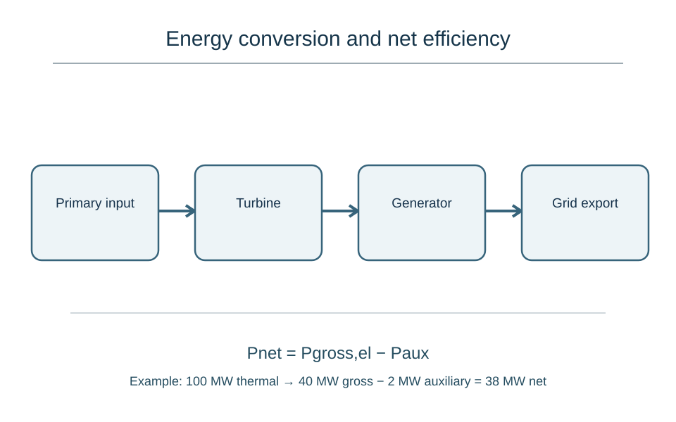

# M3-L1 – Thermal and Electromechanical Conversion {#L1}

**Course area:** M3 – Generation, Conversion and Flexibility  
**Level:** Bachelor · Advanced/elective profile  
**Prerequisites:** Basic electrical quantities and introductory mathematics.  
**Learning objective:** balance a multi-stage energy conversion chain using stage efficiencies.

## Motivating problem {#S1}

Electricity is often obtained by converting heat, fluid motion or mechanical shaft power. Assess the entire conversion chain from primary input to grid point of connection—not just the generator. A generator **converts** energy; it does not create energy in the physical sense.

## Concepts, Model and Derivation {#S2}

A series conversion chain may be modelled as $P_{k+1}=\eta_k P_k$ under compatible operating conditions. Overall efficiency is $\eta_\mathrm{total}=\prod_k\eta_k$. Thermal stations additionally depend on temperature levels, heat rejection and cycle choice. Combined heat and power also produces a useful thermal output that requires a separate balance. Gross electric generator output differs from **net injection** because station auxiliaries, transformer losses and internal demand consume some output. For a defined thermal-to-electric gross/net boundary, $P_{\mathrm{gross,el}}=\eta_{\mathrm{gross,el}}P_{\mathrm{th,in}}$ and $P_{\mathrm{net,el}}=P_{\mathrm{gross,el}}-P_{\mathrm{aux}}$, where $P_{\mathrm{aux}}$ comprises the station loads and internal losses deducted in this model.

For a generator supplied with mechanical shaft power $P_\mathrm{mech}$, a simplified relation is $P_\mathrm{el}=\eta_\mathrm G P_\mathrm{mech}$. Wind turbine mechanical power depends on flow and rotor conditions; hydropower on flow and usable head. These statements do not replace a real performance curve.

## Worked Example {#S3}

A **hypothetical** station receives $100\,\mathrm{MW}$ thermal input and has 40% gross electric conversion efficiency, yielding $40\,\mathrm{MW}$ gross. If auxiliaries and internal consumption require $2\,\mathrm{MW}$, net injection is $38\,\mathrm{MW}$. Net thermal-to-grid efficiency equals $38/100=38\,\%$. A calculation using only gross output would overstate export by $2\,\mathrm{MW}$.

## Self-Check {#S4}

### Exercises

1. A shaft supplies 12 MW. Generator and transformer efficiencies are 0.97 and 0.99. Calculate output in this model.
2. A fictitious 50 MW thermal input produces electricity at 42% gross efficiency. Auxiliary load is 1 MW: net power and net efficiency?

::: {.lc-solutions data-lc-section="S4"}
1. Electrical output downstream of the transformer is $12\cdot0.97\cdot0.99=11.5236\,\mathrm{MW}\approx11.52\,\mathrm{MW}$. Both efficiencies apply at the same operating point; further auxiliary consumption is excluded.
2. 21−1=20 MW; 40%.
:::

## Assumptions, Safety and Limits {#S5}

Identify whether figures are gross or net and which input is used for efficiency. Real efficiencies change with load and temperature; this lesson uses no measured plant performance data.

## Summary and Next Steps {#S6}

Overall efficiency across serial conversion stages follows from stage efficiencies at a consistent system boundary. Next comes variable renewable injection.

**Continue:** [M3-L2 – Photovoltaics, Wind and Grid-Connected Converters](M3-L2.md).

## Sources (external) {#S7}

- [KIT, Elektrotechnisches Institut – Vertiefungsrichtung Elektrische Energietechnik](https://www.eti.kit.edu/730.php) · Bachelor/Master specialisation overview and study plan; generation, transmission, storage, drives and control · Last accessed: 2026-11-23
- [Universität Stuttgart, Fakultät 5 – Electrical Power Systems](https://www.f05.uni-stuttgart.de/ei/studiengaenge/eeng/uebersicht/Electrical-Power-Systems/) · Electrical Power Systems degree specialisation; generation, distribution, sustainable and reliable networks · Last accessed: 2026-11-23
