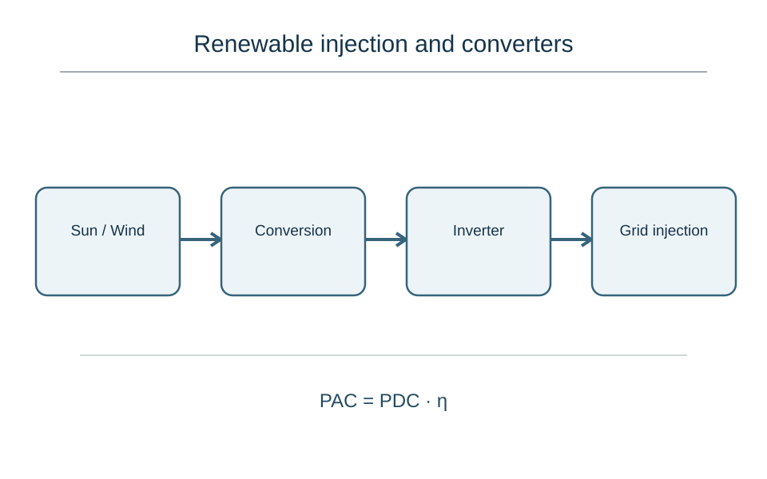

# M3-L2 – Photovoltaics, Wind and Grid-Connected Converters {#L2}

**Course area:** M3 – Generation, Conversion and Flexibility  
**Level:** Bachelor · Advanced/elective profile  
**Prerequisites:** Basic electrical quantities and introductory mathematics.  
**Learning objective:** calculate a simplified PV or wind injection model and explain the converter interface.

## Motivating problem {#S1}

Photovoltaic systems first produce DC electricity; connection to an AC grid requires a suitable inverter. Wind turbines convert fluid kinetic energy into mechanical and then electrical output. Weather-dependent injection produces time profiles unlike those of dispatchable thermal stations.

## Concepts, Model and Derivation {#S2}

A rough photovoltaic approximation is $P_\mathrm{AC}\approx P_\mathrm{STC}(G/G_\mathrm{ref})f_\mathrm{temp}\eta_\mathrm{inv}$, with reference capacity $P_\mathrm{STC}$, plane-of-array irradiance $G$, temperature/operating factor $f_\mathrm{temp}$ and inverter efficiency $\eta_\mathrm{inv}$. The proportional model only applies within its operating region; it omits other losses and clipping.

Ideal wind-stream power is $P_\mathrm{wind}=\tfrac12\rho A v^3$. Only part can be extracted by the rotor; real power curves, controls and cut-out conditions limit generation. Grid-connected converters may control real power and provide reactive-power support within their capabilities. Actual connection requirements depend on the jurisdiction, network level and valid technical rules.

## Worked Example {#S3}

Consider an **illustrative** $8\,\mathrm{kW}$ PV array at 60% of reference irradiance. Combine temperature, inverter and other losses into factor $0.90$. Output is approximately $8(0.6)(0.9)=4.32\,\mathrm{kW}$. If a fictional dispatch decision curtails 10% of this value, exported power becomes $3.888\,\mathrm{kW}$. Curtailment and low irradiance are distinct causes.

### Further study 1

**Learning objective:** Interpret a simplified inverter P-Q limit and distinguish power capability from available energy.

For balanced sinusoidal three-phase quantities and an assumed constant apparent power rating, $P^2+Q^2\le S_\mathrm{N}^2$. This simplified circular capability curve can be restricted further by actual current, thermal, voltage and DC-side limits. Positive P denotes injection here; the reactive power direction requires an explicit sign convention. Only the magnitude of Q is calculated.

An inverter rated at $S_\mathrm{N}=100\,\mathrm{kVA}$ injects $P=80\,\mathrm{kW}$. Its reactive power magnitude is limited to $|Q|_\mathrm{max}=\sqrt{100^2-80^2}=60\,\mathrm{kvar}$. If 75 kvar is required, the maximum active power becomes $\sqrt{100^2-75^2}=66.14\,\mathrm{kW}$. With 80 kW still available, at least 13.86 kW must not be injected in this teaching model. Over a constant quarter-hour interval this corresponds to 3.46 kWh. Whether that energy can be stored or is lost depends on the DC side.

Grid-following and grid-forming control must be distinguished from this steady-state P-Q limit. Grid-following control typically synchronises to an existing grid voltage reference. Grid-forming control establishes its own voltage reference and can contribute to frequency and voltage regulation. Neither label guarantees unrestricted island operation, black-start capability or any particular fault current contribution. Additional active power requires an appropriate energy source and power headroom.

## Self-Check {#S4}

### Exercises

1. By what factor does ideal available wind-stream power increase when speed doubles from 5 to 10 m/s, all else equal? Why is that not a guaranteed electrical output increase?
2. A simplified PV system supplies 6 kW before curtailment for 30 min. A 4 kW cap applies throughout. Find delivered and curtailed energy.
3. What reactive power headroom remains at 96 kW and 100 kVA?
4. Can 80 kW and 75 kvar be supplied simultaneously?
5. How much additional energy is required for 20 kW of active power support over 10 s, neglecting losses?

::: {.lc-solutions data-lc-section="S4"}
1. The ideal ratio is $(10/5)^3=8$. Turbine power curves, rated power and control limits prevent a universal eightfold change in grid export.
2. 2 kWh delivered; 1 kWh curtailed.
3. 28 kvar.
4. $S=109.66\,\mathrm{kVA}$, so not within the assumed model.
5. 200 kJ or 0.0556 kWh; energy and power limits must be checked separately.
:::

## Assumptions, Safety and Limits {#S5}

These models are not yield forecasts. Inverters are dangerous electrical equipment; no live connection or settings procedure is provided. Annual energy needs weather profiles and site-specific loss models.

**German low-voltage example (web review 23 November 2026):** VDE FNN identifies VDE-AR-N 4105:2026-03 as the technical connection rule for low-voltage generation facilities. Its scope includes interface protection, operation and verification of electrical properties; network-operator-specific TAB also apply. No installation, testing or parameter-setting values are inferred from the public overview.

## Summary and Next Steps {#S6}

Renewable injection varies with environmental conditions and technical limits. Power electronics provide the grid interface; storage shifts delivery in time.

**Continue:** [M3-L3 – Storage, State of Charge and Sector Coupling](M3-L3.md).

## Sources (external) {#S7}

- [KIT, Elektrotechnisches Institut – Vertiefungsrichtung Elektrische Energietechnik](https://www.eti.kit.edu/730.php) · Bachelor/Master specialisation overview and study plan; generation, transmission, storage, drives and control · Last accessed: 2026-11-23
- [Universität Stuttgart, Fakultät 5 – Electrical Power Systems](https://www.f05.uni-stuttgart.de/ei/studiengaenge/eeng/uebersicht/Electrical-Power-Systems/) · Electrical Power Systems degree specialisation; generation, distribution, sustainable and reliable networks · Last accessed: 2026-11-23
- [University of Stuttgart – Examination regulations No. 36/2025](https://www.uni-stuttgart.de/universitaet/aktuelles/bekanntmachungen/Amtliche-Bekanntmachung-Nummer-36-2025/) · Annex 2, section 5(2)(a), grid/renewables modules in the selected BSc elective area · Web view checked: 2026-11-23
- [VDE FNN – Low-voltage generation rules, VDE-AR-N 4105:2026-03](https://www.vde.com/de/fnn/themen/tar/tar-niederspannung/erzeugungsanlagen-am-niederspannungsnetz-vde-ar-n-4105-2018) · Generation facilities, protection, operation and verification; public overview, not full standard text · Web view checked: 2026-11-23
- [U.S. Department of Energy – UNIFI Consortium](https://www.energy.gov/cmei/systems/unifi-consortium) · What are Grid Forming Inverters?; grid-forming and grid-following principles · Last accessed: 2026-11-24
