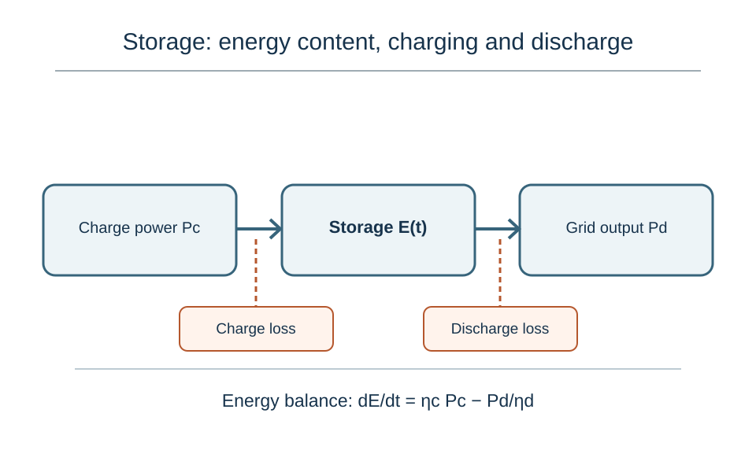

# M3-L3 – Storage, State of Charge and Sector Coupling {#L3}

**Course area:** M3 – Generation, Conversion and Flexibility  
**Level:** Bachelor · Advanced/elective profile  
**Prerequisites:** Basic electrical quantities and introductory mathematics.  
**Learning objective:** update stored energy using charging/discharging power and efficiency.

## Motivating problem {#S1}

Energy storage separates the time of charging from the time of discharge. Two grid-facing limits matter: available instantaneous **power** (MW) and stored **energy** (MWh). A large energy rating does not imply unlimited discharge power.

## Concepts, Model and Derivation {#S2}

Let $E(t)$ denote usable stored energy, $P_\mathrm c\ge0$ charging power and $P_\mathrm d\ge0$ electrical discharge power. With charging and discharging efficiencies $\eta_\mathrm c$ and $\eta_\mathrm d$, the basic model is $\mathrm dE/\mathrm dt=\eta_\mathrm cP_\mathrm c-P_\mathrm d/\eta_\mathrm d$. State of charge is $SOC=E/E_\mathrm{max}$. Charge and discharge powers also have limits; simultaneous operation is excluded in this exercise.

Sector coupling links electricity with heating, mobility and chemical fuels. An electrolyser, for example, uses electrical input to produce chemical energy. The system boundary and conversion efficiencies must be explicit. Batteries and hydrogen-based pathways serve different applications with different losses.

## Worked Example {#S3}

A hypothetical store has $E_\mathrm{max}=20\,\mathrm{MWh}$ and initially contains $8\,\mathrm{MWh}$. Charging at $4\,\mathrm{MW}$ for two hours with $\eta_\mathrm c=0.90$ adds $7.2\,\mathrm{MWh}$, yielding $15.2\,\mathrm{MWh}$. One hour of $3\,\mathrm{MW}$ electric output at $\eta_\mathrm d=0.90$ withdraws $3/0.90\approx3.33\,\mathrm{MWh}$ internally. The remainder is about $11.87\,\mathrm{MWh}$ or 59.3% SOC.

## Self-Check {#S4}

### Exercises

1. How many hours can the same store, initially at 60% SOC, export a constant 3 MW if discharge efficiency is 90% and no minimum SOC applies?
2. Storage contains 5 MWh, with minimum energy 2 MWh, discharge efficiency 80% and output 2 MW. How long can it supply power?

::: {.lc-solutions data-lc-section="S4"}
1. Energy stored is $0.60(20)=12\,\mathrm{MWh}$. Deliverable electric energy is $12(0.90)=10.8\,\mathrm{MWh}$. Duration is $10.8/3=3.6\,\mathrm h$. Actual systems impose additional restrictions.
2. (5−2)×0.8/2=1.2 h; the power limit must permit 2 MW.
:::

## Assumptions, Safety and Limits {#S5}

The model omits self-discharge, aging, temperature and auxiliary demand. It is not a battery-safety or connection procedure; professional system rules are separate.

## Summary and Next Steps {#S6}

Stored energy, power limits and separate losses govern storage state. Dispatch over time affects network flows, modelled in the next module.

**Continue:** [M4-L1 – Buses, Branches and Grid States](M4-L1.md).

## Sources (external) {#S7}

- [TU Dresden, Fakultät Elektrotechnik und Informationstechnik – Wahlpflichtmodule ET, MT, IST, RES](https://tu-dresden.de/ing/elektrotechnik/studium/im_studium/lehrangebot/wahlpflichtmodule) · Fundamentals of Energy Storage / Innovative Applications of Energy Storage Systems; electrical, thermal and mechanical storage, sector coupling · Last accessed: 2026-11-23
- [KIT, Elektrotechnisches Institut – Vertiefungsrichtung Elektrische Energietechnik](https://www.eti.kit.edu/730.php) · Bachelor/Master specialisation overview and study plan; generation, transmission, storage, drives and control · Last accessed: 2026-11-23
- [PyPSA – Storage](https://docs.pypsa.org/latest/user-guide/optimization/storage/) · Storage Units; time-coupled storage balance and cyclic boundary condition · Last accessed: 2026-11-24
