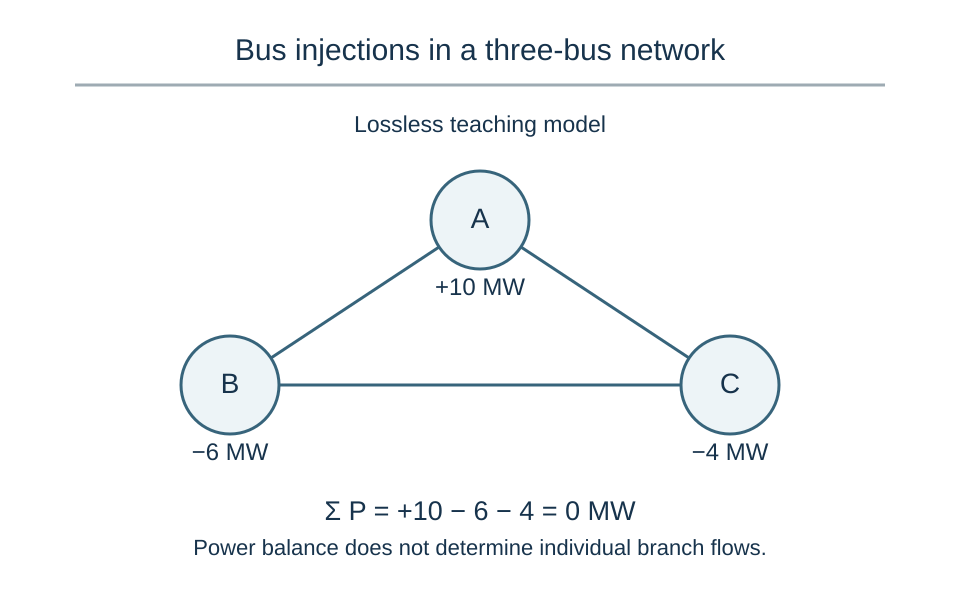

# M4-L1 – Buses, Branches and Grid States {#L1}

**Course area:** M4 – Grid Modelling and Power Flow  
**Level:** Bachelor · Advanced/elective profile  
**Prerequisites:** Basic electrical quantities and introductory mathematics.  
**Learning objective:** balance bus injections with a consistent sign convention.

## Motivating problem {#S1}

Power flow is not an arbitrary arrow drawn on a map. It results from connectivity, complex bus voltages, line parameters and power injections. **Buses** represent electrical connection points; **branches** are lines or transformers.

## Concepts, Model and Derivation {#S2}

At bus $i$, injected complex current is $I_i=\sum_jY_{ij}V_j$. Matrix $Y$ is the bus admittance matrix. Complex power injection is $S_i=P_i+\mathrm jQ_i=V_iI_i^*$ where $^*$ is complex conjugation. Choose **injection positive**; the opposite convention is also possible if consistently stated.

In a lossless network, $\sum_iP_i=0$. For a real network, generation must also cover losses. In AC power-flow studies a bus may be represented as slack/reference, PV or PQ depending on which variables are fixed and which are unknown.

## Worked Example {#S3}

In a **lossless** three-bus network, A injects $10\,\mathrm{MW}$; B consumes $6\,\mathrm{MW}$ and C consumes $4\,\mathrm{MW}$. Net injections are $(+10,-6,-4)\,\mathrm{MW}$ and sum to zero. This does **not** determine flows in branches A–B, A–C or B–C. Impedances and bus states are needed.

### Further study 1

For a balanced three-phase system, select a common apparent-power base $S_B$ and a line-to-line voltage base $U_B$ at each voltage level. Then $I_B=S_B/(\sqrt3 U_B)$ and $Z_B=U_B^2/S_B$. An impedance $Z$ becomes dimensionless as $z=Z/Z_B$. Choose voltage bases across an ideal transformer in the ratio of its rated voltages. The ideal ratio can then disappear from the per-unit equivalent circuit; actual leakage impedance and losses remain.

Example: $S_B=10\,\mathrm{MVA}$ and $U_B=20\,\mathrm{kV}$ give $I_B=288.675\,\mathrm A$ and $Z_B=40\,\Omega$. A series impedance of $2+\mathrm j4\,\Omega$ corresponds to $0.05+\mathrm j0.10$ p.u. On changing bases, $z_{new}=z_{old}(S_{B,new}/S_{B,old})(U_{B,old}/U_{B,new})^2$. With the same voltage and twice the power base, $z_{new}=0.10+\mathrm j0.20$ p.u. The physical impedance remains unchanged.

## Self-Check {#S4}

### Exercises

1. Two loads consume 5 MW and 7 MW in a lossless network. What total generation is required? What additional factor is needed for a realistic balance?
2. Two loads draw 8 MW in total; network losses in the given state are 0.3 MW. Find required total generation.
3. Find the current and impedance bases for 5 MVA and 10 kV.
4. Express a line impedance of $1+\mathrm j2\,\Omega$ in per unit.

::: {.lc-solutions data-lc-section="S4"}
1. Generation equals 12 MW in the lossless case. A realistic network additionally requires generation to cover resistive losses.
2. 8.3 MW; balance alone does not determine individual branch flows.
3. $I_B=288.675\,\mathrm A$, $Z_B=20\,\Omega$.
4. $z=0.05+\mathrm j0.10$ p.u.
:::

## Assumptions, Safety and Limits {#S5}

The admittance model assumes a suitable stationary sinusoidal state. Transients, harmonics and faults need other methods; no real high-voltage experiment is implied.

## Summary and Next Steps {#S6}

Bus equations connect injections, withdrawals and branch flows. A linearised treatment next simplifies active-power flow analysis.

**Continue:** [M4-L2 – Linearised DC Power Flow](M4-L2.md).

## Sources (external) {#S7}

- [KIT, Institut für Elektroenergiesysteme und Hochspannungstechnik – Elektrische Energienetze](https://www.ieh.kit.edu/2448_bee.php) · EEN lecture contents (winter semester), sections 1–5; three-phase power, power flow, networks and faults · Last accessed: 2026-11-23
- [TU Dresden, Fakultät Elektrotechnik und Informationstechnik – Wahlpflichtmodule ET, MT, IST, RES](https://tu-dresden.de/ing/elektrotechnik/studium/im_studium/lehrangebot/wahlpflichtmodule) · Planning of Electrical Power Systems / Fundamentals of Electrical Power Systems / Controlled Power Systems; network planning, calculations, equipment and control · Last accessed: 2026-11-23
