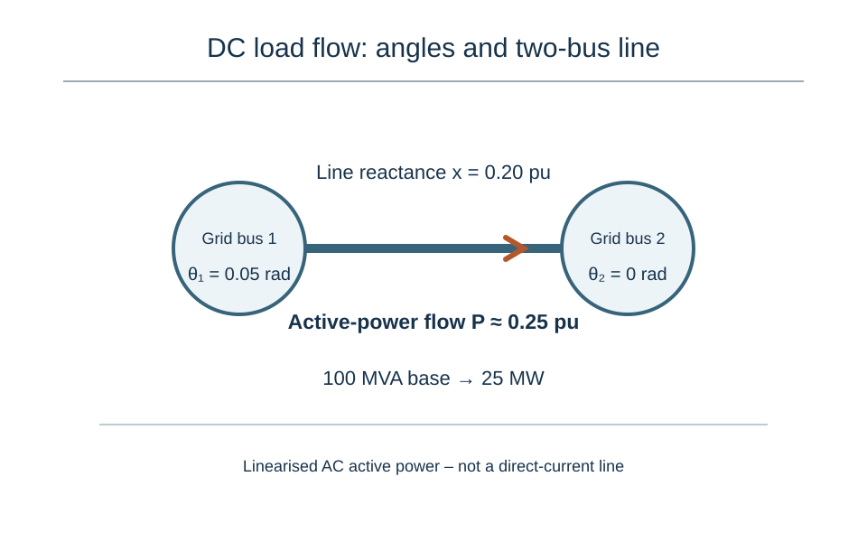

# M4-L2 – Linearised DC Power Flow {#L2}

**Course area:** M4 – Grid Modelling and Power Flow  
**Level:** Bachelor · Advanced/elective profile  
**Prerequisites:** Basic electrical quantities and introductory mathematics.  
**Learning objective:** state DC power-flow assumptions and compute a per-unit active-power flow.

## Motivating problem {#S1}

A full AC power flow is nonlinear. For quick comparisons of transmission paths, engineers often use the **DC power-flow approximation**. Despite its name this models an **AC grid**, not a physical DC transmission system, and requires strong assumptions.

## Concepts, Model and Derivation {#S2}

Typical assumptions include voltage magnitudes near 1 per unit, small angle differences, negligible resistance, reactive flows and losses, and balanced operation. Under these assumptions, the per-unit real power from bus $i$ to bus $j$ is $p_{ij}\approx(\theta_i-\theta_j)/x_{ij}$, with angles in radians and line reactance in per unit.

Choosing a reference angle yields linear equations $B\boldsymbol\theta=\boldsymbol p$ for nodal real-power balance. This is useful for sensitivity and congestion comparisons. It does not provide reliable voltage profiles, reactive-power limits or resistive losses.

## Worked Example {#S3}

A two-bus model has line reactance $x=0.20$ pu and angle difference $\theta_1-\theta_2=0.05\,\mathrm{rad}$. The approximate flow is $p_{12}=0.05/0.20=0.25$ pu. On a system base of $100\,\mathrm{MVA}$, this corresponds to $25\,\mathrm{MW}$ of real power under the assumptions. The per-unit base, sign and angular reference must be specified.

### Further study 1

In the DC teaching model of a connected network with series reactances $x_{ij}>0$, $p_{ij}=(\theta_i-\theta_j)/x_{ij}$. Use a common 100 MVA base, angles in radians, voltage magnitudes of 1 p.u., and no losses, shunts, tap ratios or phase shifts. Reference bus A has $\theta_A=0$. B consumes 30 MW and C 60 MW. The three branches A–B, A–C and B–C each have $x=0.10$ p.u. Bus balance gives:

$$\begin{pmatrix}20&-10\\-10&20\end{pmatrix}\begin{pmatrix}\theta_B\\\theta_C\end{pmatrix}=\begin{pmatrix}-0.30\\-0.60\end{pmatrix}.$$

The solution is $\theta_B=-0.04$, $\theta_C=-0.05$. Branch flows are A→B 40 MW, A→C 50 MW and B→C 10 MW. B receives a net 30 MW, C 60 MW; A supplies 90 MW. Identical reactances do not necessarily imply identical flows. The selected angle reference makes the equations uniquely solvable. In an electrically disconnected system, every island requires its own reference and consistent power balance; an unserved load must not disappear from the calculation.

## Self-Check {#S4}

### Exercises

1. If reactance doubles to 0.40 pu while angle difference stays 0.05 rad in the same model, what flow results?
2. A branch has x=0.25 p.u. and angle difference −0.05 rad on a 100 MVA base. Find the signed DC flow.
3. Check the balances at B and C and the closed angle loop.
4. What changes at identical injections if all reactances double?

::: {.lc-solutions data-lc-section="S4"}
1. $p=0.05/0.40=0.125$ pu, or $12.5\,\mathrm{MW}$ on the same base. This is conditional on keeping angle difference fixed.
2. −0.2 p.u. = −20 MW, opposite to the reference direction.
3. B: $40-10=30$ MW; C: $50+10=60$ MW. Angle loop A→B→C→A: $0.04+0.01-0.05=0$ rad.
4. The angles become −0.08 and −0.10 rad; branch flows remain unchanged in the linear model. Larger angles can degrade the model approximation.
:::

## Assumptions, Safety and Limits {#S5}

DC power flow is not an accurate voltage study and must not be used for protection settings, imbalanced feeders or highly resistive systems without validation. DC here refers to the approximation, not HVDC hardware.

## Summary and Next Steps {#S6}

DC power flow is a linearisation of an AC grid with fixed voltage magnitudes and no reactive-power solution. Full AC equations address some of those omissions.

**Continue:** [M4-L3 – AC Power Flow and Model Limits](M4-L3.md).

## Sources (external) {#S7}

- [KIT, Institut für Elektroenergiesysteme und Hochspannungstechnik – Elektrische Energienetze](https://www.ieh.kit.edu/2448_bee.php) · EEN lecture contents (winter semester), sections 1–5; three-phase power, power flow, networks and faults · Last accessed: 2026-11-23
- [TU Dresden, Fakultät Elektrotechnik und Informationstechnik – Wahlpflichtmodule ET, MT, IST, RES](https://tu-dresden.de/ing/elektrotechnik/studium/im_studium/lehrangebot/wahlpflichtmodule) · Planning of Electrical Power Systems / Fundamentals of Electrical Power Systems / Controlled Power Systems; network planning, calculations, equipment and control · Last accessed: 2026-11-23
- [MATPOWER – DC Power Flow](https://matpower.app/manual/matpower/DCPowerFlow.html) · § 4.2; reduced bus matrix and branch flows · Last accessed: 2026-11-24
