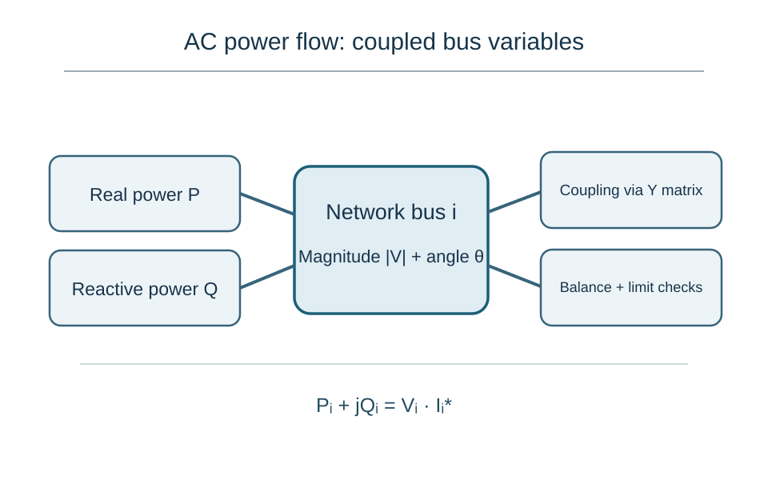

# M4-L3 – AC Power Flow and Model Limits {#L3}

**Course area:** M4 – Grid Modelling and Power Flow  
**Level:** Bachelor · Advanced/elective profile  
**Prerequisites:** Basic electrical quantities and introductory mathematics.  
**Learning objective:** interpret bus P/Q balances and the limits of stationary AC power flow.

## Motivating problem {#S1}

Grid analysis becomes more demanding when voltage magnitudes and both real and reactive powers must be solved together. **AC load flow** solves nonlinear equations to test whether a proposed operating point is consistent with the chosen network and injection models.

## Concepts, Model and Derivation {#S2}

With bus admittances $Y_{ij}=G_{ij}+\mathrm jB_{ij}$ and $\theta_{ij}=\theta_i-\theta_j$, the steady-state injection equations are

$$P_i=\sum_j |V_i||V_j|\left(G_{ij}\cos\theta_{ij}+B_{ij}\sin\theta_{ij}\right),$$

$$Q_i=\sum_j |V_i||V_j|\left(G_{ij}\sin\theta_{ij}-B_{ij}\cos\theta_{ij}\right).$$

Unknowns include voltage angles and magnitudes. Newton methods linearise locally through a Jacobian and iterate until mismatch tolerances are met. Numerical convergence does **not** prove dynamic stability or compliance with all thermal and control constraints.

## Worked Example {#S3}

As a consistency check for a hypothetical balanced load-flow operating point, take $P=200\,\mathrm{kW}$, $Q=120\,\mathrm{kvar}$ and $U_\mathrm{LL}=400\,\mathrm V$. Apparent power magnitude is $|S|=\sqrt{200^2+120^2}\approx233.24\,\mathrm{kVA}$. Under balanced sinusoidal assumptions, $I=|S|/(\sqrt3\,U_\mathrm{LL})\approx336.7\,\mathrm A$. Without line data this is not an assessment of permissible loading.

### Further study 1

A reference bus at $V_1=1\angle0$ p.u. supplies a PQ load bus $V_2=v\angle\theta$ through a lossless series reactance $X=0.2$ p.u. The load consumes $p=0.5$ and $q=0.2$ p.u.; these are positive consumption values. Under the injection convention, bus 2 satisfies $-p=v\sin\theta/X$ and $-q=(v^2-v\cos\theta)/X$. Hence $v\sin\theta=-Xp$ and $v\cos\theta=v^2+Xq$. Squaring and adding gives $y^2+(2Xq-1)y+X^2(p^2+q^2)=0$ for $y=v^2$.

The larger root gives $y\approx0.9072136$, $v\approx0.95248$ and $\theta\approx-6.03^\circ$. The second root corresponds to a very low voltage magnitude; it cannot be presumed to be an admissible operating solution. The reference bus supplies 0.5 p.u. active power and approximately 0.26393 p.u. reactive power. The difference from the load reactive power is the inductive demand of the series reactance. On a 10 MVA base, 0.5 p.u. equals 5 MW.

## Self-Check {#S4}

### Exercises

1. Why can a converged load-flow result still be physically or operationally unacceptable? Give two reasons.
2. A pure series branch with X=0.2 p.u. connects buses at equal voltage magnitudes of 1 p.u. and equal angle. Find P and Q without shunt admittance.
3. Substitute the high-voltage solution into both injection equations and check the signs.
4. Why does this result not establish dynamic stability?

::: {.lc-solutions data-lc-section="S4"}
1. Examples include a thermal line overload, voltage limits violated, reactive power beyond equipment capability or inconsistent modelling assumptions.
2. No voltage difference, hence I=0 and P=Q=0 at both ends.
3. The results are approximately -0.5 p.u. and -0.2 p.u.; negative injection represents consumption.
4. The equations describe only a steady state. Controller, protection and dynamic load models are absent.
:::

## Assumptions, Safety and Limits {#S5}

AC power flow is quasi-static. Transient stability, short circuits, harmonics and other dynamics need other models. The chosen example voltage is not a universally permitted connection value.

## Summary and Next Steps {#S6}

AC power flow solves nonlinear stationary balances but neither faults nor transient stability. Frequency dynamics therefore require a separate model.

**Continue:** [M5-L1 – Frequency and Active-Power Imbalance](M5-L1.md).

## Sources (external) {#S7}

- [KIT, Institut für Elektroenergiesysteme und Hochspannungstechnik – Elektrische Energienetze](https://www.ieh.kit.edu/2448_bee.php) · EEN lecture contents (winter semester), sections 1–5; three-phase power, power flow, networks and faults · Last accessed: 2026-11-23
- [TU Dresden, Fakultät Elektrotechnik und Informationstechnik – Wahlpflichtmodule ET, MT, IST, RES](https://tu-dresden.de/ing/elektrotechnik/studium/im_studium/lehrangebot/wahlpflichtmodule) · Planning of Electrical Power Systems / Fundamentals of Electrical Power Systems / Controlled Power Systems; network planning, calculations, equipment and control · Last accessed: 2026-11-23
