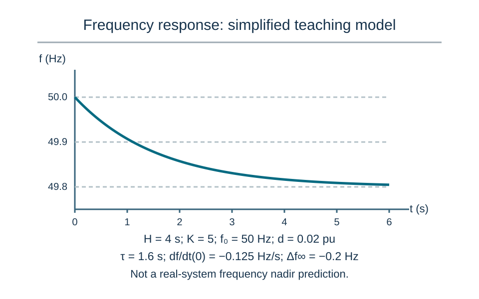

# M5-L1 – Frequency and Active-Power Imbalance {#L1}

**Course area:** M5 – Grid Operation, Dynamics and Protection  
**Level:** Bachelor · Advanced/elective profile  
**Prerequisites:** Basic electrical quantities and introductory mathematics.  
**Learning objective:** calculate the initial frequency rate of change using an idealised swing equation.

## Motivating problem {#S1}

In a synchronous AC power system, frequency is a shared dynamic quantity. If electrical demand suddenly exceeds supply, the aggregate rotation of synchronous machines initially slows. Frequency may drop until control and reserve responses improve the balance.

## Concepts, Model and Derivation {#S2}

An extremely simplified aggregate swing equation is $2H\,\mathrm d(f/f_0)/\mathrm dt=\Delta P_\mathrm{pu}$ where $H$ is inertia constant in seconds, $f_0$ is reference frequency and $\Delta P_\mathrm{pu}$ is the net active-power disturbance on a consistent system base. Positive means surplus generation. Initially, $\mathrm df/\mathrm dt=f_0\Delta P_\mathrm{pu}/(2H)$ if load damping and controls are neglected.

Inertial response differs from frequency containment and subsequent restoration. Generation, flexible demand and suitable converter resources can participate in control. Actual products and requirements depend on the synchronous area and current rules. A frequency deviation does not locate a specific line overload.

**Consistent power base:** In this aggregated model, the per-unit power imbalance and the inertia constant must refer to the same power base. When combining machines, their inertia constants need appropriate power-base weighting. The assumed constant $H$ does not mean that every grid-connected converter inherently provides physical inertia.

## Worked Example {#S3}

For an **illustrative aggregate model**, take $f_0=50\,\mathrm{Hz}$, $H=4\,\mathrm s$ and an initial shortfall $\Delta P_\mathrm{pu}=-0.02$. The initial rate is $\mathrm df/\mathrm dt=50(-0.02)/(2(4))=-0.125\,\mathrm{Hz/s}$. This is only an initial slope; extrapolating it would ignore control and demand response.

### Further study 1

**Learning objective:** Distinguish initial slope, steady-state deviation and time constant.

Extend the existing aggregate swing model by adding an idealised proportional counteraction. Let $x=(f-f_0)/f_0$ be dimensionless frequency deviation. For a constant power deficit $d>0$ in pu, $2H\dot x=-d-Kx$. Here $K>0$ combines the static effect of frequency-dependent demand and instantaneous proportional power response, in pu power per pu frequency deviation. With $x(0)=0$, the linear differential equation gives $x(t)=-(d/K)(1-\exp(-Kt/(2H)))$. The time constant is $\tau=2H/K$ and the limiting frequency deviation is $\Delta f_\infty=-f_0d/K$.

Using $H=4\,\mathrm s$, $f_0=50\,\mathrm{Hz}$, $d=0.02$ and $K=5$ gives an initial slope of −0.125 Hz/s, a time constant of 1.6 s and a steady-state deviation of −0.2 Hz. After 1.6 s the frequency is about 49.874 Hz; after 4.8 s about 49.810 Hz. The model response is monotonic and approaches 49.8 Hz. Without feedback ($K=0$), the model instead yields a straight line. The limit is meaningful at finite time, but there is no steady-state value for K=0 in this case.

Instantaneous feedback is a teaching idealisation; actual controllers involve delays, power limits and further state variables. The model therefore cannot predict an actual frequency nadir, nor does it model restoration of nominal frequency by additional control. Use the same power base as in the existing lesson. These are not operational settings.

## Self-Check {#S4}

### Exercises

1. Under the same simplified equation, what is the initial frequency rate if inertia doubles to H = 8 s with the same disturbance?
2. An aggregate teaching model has f0=50 Hz, H=5 s, initial power deficit 0.03 p.u. Find the initial frequency slope.
3. How do time constant and steady-state deviation change for H=8 s?
4. How do they change for K=10 and H=4 s?
5. Why is the limiting value not an actual frequency nadir?

::: {.lc-solutions data-lc-section="S4"}
1. $\mathrm df/\mathrm dt=50(-0.02)/(2(8))=-0.0625\,\mathrm{Hz/s}$. The initial slope has half the magnitude. This does not establish any actual equipment frequency set point.
2. −0.15 Hz/s; not a linear long-term forecast.
3. 3.2 s and −0.2 Hz, respectively.
4. 0.8 s and −0.1 Hz. The initial slope remains −0.125 Hz/s.
5. Dynamic delays and saturation are absent; actual systems can initially fall further and subsequently recover.
:::

## Assumptions, Safety and Limits {#S5}

50 Hz represents the selected continental-European example, not a worldwide default. Actual frequency standards, reserve obligations and protective actions need current regional documentation and are not specified here.

## Summary and Next Steps {#S6}

The initial power deficit and modelled inertia determine the first frequency rate of change. Congestion management instead concerns where power flows.

**Continue:** [M5-L2 – Reserves, Congestion and Redispatch](M5-L2.md).

## Sources (external) {#S7}

- [KIT, Institut für Elektroenergiesysteme und Hochspannungstechnik – Elektrische Energienetze](https://www.ieh.kit.edu/2448_bee.php) · EEN lecture contents (winter semester), sections 1–5; three-phase power, power flow, networks and faults · Last accessed: 2026-11-23
- [TU Dresden, Fakultät Elektrotechnik und Informationstechnik – Wahlpflichtmodule ET, MT, IST, RES](https://tu-dresden.de/ing/elektrotechnik/studium/im_studium/lehrangebot/wahlpflichtmodule) · Planning of Electrical Power Systems / Fundamentals of Electrical Power Systems / Controlled Power Systems; network planning, calculations, equipment and control · Last accessed: 2026-11-23
