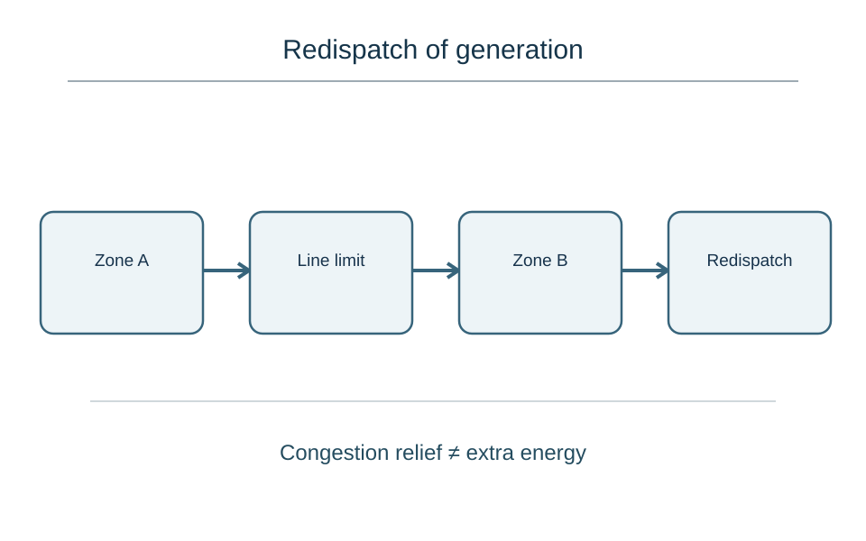

# M5-L2 – Reserves, Congestion and Redispatch {#L2}

**Course area:** M5 – Grid Operation, Dynamics and Protection  
**Level:** Bachelor · Advanced/elective profile  
**Prerequisites:** Basic electrical quantities and introductory mathematics.  
**Learning objective:** balance lossless two-zone redispatch and distinguish it from frequency regulation.

## Motivating problem {#S1}

Balanced total generation does not guarantee safe power flows on every line. When a corridor is overloaded, injection, withdrawal or topology must change appropriately. **Redispatch** moves generation geographically while seeking to preserve the overall energy balance.

## Concepts, Model and Derivation {#S2}

In a simplified two-zone lossless model, $P_{G,A}+P_{G,B}=P_{L,A}+P_{L,B}$. With no local load in zone A, corridor flow is approximately $P_{A\to B}=P_{G,A}$. If it exceeds a limit $P_\mathrm{max}$, paired changes $\Delta P_{G,A}<0$ and $\Delta P_{G,B}>0$ with zero sum can relieve the corridor.

**Balancing reserve** responds to aggregate active-power imbalance and frequency needs; **redispatch** primarily addresses spatial network constraints. Resources, timescales and legal processes can differ. The German Federal Network Agency explains redispatch as changes to generation that relieve potentially overloaded sections of the grid; exact legal procedures are time-sensitive.

## Worked Example {#S3}

In a **lossless teaching model**, zone B demands $100\,\mathrm{MW}$. Zone A generates 80 MW and zone B 20 MW. A corridor can carry at most 70 MW, but initial flow would be 80 MW. Reducing generation in A by 15 MW to 65 MW and increasing B by 15 MW to 35 MW preserves total generation at 100 MW and lowers model corridor flow to 65 MW. Actual feasibility and cost need separate assessments.

## Self-Check {#S4}

### Exercises

1. What is the smallest matched generation shift that moves model corridor flow from 80 MW down to the stated 70 MW limit?
2. Zone A exports 55 MW to B, with a fictitious limit of 45 MW. Find the minimum paired generation change in a lossless two-zone model.

::: {.lc-solutions data-lc-section="S4"}
1. Reduce A by 10 MW and increase B by 10 MW. The model balance remains unchanged and flow reaches the 70 MW cap, before considering real operational constraints.
2. A −10 MW, B +10 MW; total generation unchanged.
:::

## Assumptions, Safety and Limits {#S5}

This is a conceptual model, not an operational redispatch instruction. Applicable law, procurement, compensation and ratings depend on country, network and date.

## Summary and Next Steps {#S6}

Redispatch changes the spatial injection pattern while maintaining system balance. Grid faults additionally require selective protection.

**Continue:** [M5-L3 – Fault Conditions and Protection Principles](M5-L3.md).

## Sources (external) {#S7}

- [Bundesnetzagentur – Redispatch](https://www.bundesnetzagentur.de/DE/Fachthemen/ElektrizitaetundGas/Versorgungssicherheit/Netzengpassmanagement/Engpassmanagement/Redispatch/artikel.html) · Redispatch introduction and sections; grid congestion, generation adjustments and reactive power · Last accessed: 2026-11-23
- [KIT, Institut für Elektroenergiesysteme und Hochspannungstechnik – Elektrische Energienetze](https://www.ieh.kit.edu/2448_bee.php) · EEN lecture contents (winter semester), sections 1–5; three-phase power, power flow, networks and faults · Last accessed: 2026-11-23
