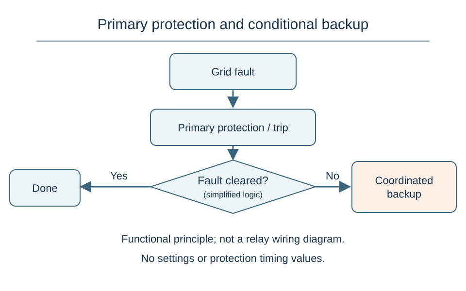

# M5-L3 – Fault Conditions and Protection Principles {#L3}

**Course area:** M5 – Grid Operation, Dynamics and Protection  
**Level:** Bachelor · Advanced/elective profile  
**Prerequisites:** Basic electrical quantities and introductory mathematics.  
**Learning objective:** calculate a simplified Thevenin fault model and explain protection selectivity.

## Motivating problem {#S1}

Short circuits can change voltage and current rapidly. Network protection aims to detect faults and disconnect affected sections. Key goals include **selectivity** (isolate the faulty zone), **speed**, **sensitivity** and **dependability**. Detailed design depends on the actual grid.

## Concepts, Model and Derivation {#S2}

An extremely simplified Thevenin model gives $I_\mathrm{fault}=U_\mathrm{Th}/|Z_\mathrm{Th}+Z_\mathrm{fault}|$. This only approximates one selected single-phase or balanced fault case; dynamic effects are omitted. Fault current can be far above normal operating current. In a multiphase system, fault type, earthing, generator and converter contributions and timing matter.

Protection may monitor current, voltage, direction or impedance. **Protection coordination** uses primary devices to isolate a designated zone while separate backup protection handles failure of the primary element. Real equipment settings require validated engineering studies and current requirements.

## Worked Example {#S3}

For an explicitly **hypothetical** single-phase Thevenin circuit take $U_\mathrm{Th}=230\,\mathrm V$, $R=0.10\,\Omega$, $X=0.30\,\Omega$ and negligible additional fault impedance. $|Z|=\sqrt{0.10^2+0.30^2}\approx0.316\,\Omega$. Current magnitude is approximately $I_\mathrm{fault}=230/0.316\approx727\,\mathrm A$. This is **not** a basis for selecting a protective device or tripping time.

### Further study 1

With $a=\exp(\mathrm j2\pi/3)$, three complex phase quantities can be decomposed into zero-, positive- and negative-sequence components. For voltages, $V_0=(V_a+V_b+V_c)/3$, $V_1=(V_a+aV_b+a^2V_c)/3$, and $V_2=(V_a+a^2V_b+aV_c)/3$. The inverse transformation is $V_a=V_0+V_1+V_2$, $V_b=V_0+a^2V_1+aV_2$, and $V_c=V_0+aV_1+a^2V_2$. This is a linear transformation of phasors at the same frequency; fault calculations additionally require the relevant sequence networks and their connections according to the fault type.

Example: $V_a=1$, $V_b=0$, $V_c=0$ p.u. All three components equal 1/3 p.u. The example illustrates the transformation and is not a real short-circuit operating point.

## Self-Check {#S4}

### Exercises

1. Why might disconnecting the entire grid for every individual fault be unacceptable even when it isolates the fault?
2. In a hypothetical Thevenin model, the prefault voltage is unchanged while total impedance magnitude doubles. How does modelled fault-current magnitude change?
3. Decompose $V_a=1$, $V_b=a^2$, $V_c=a$.
4. Why can an unbalanced disturbance not generally be calculated with only the positive-sequence impedance?

::: {.lc-solutions data-lc-section="S4"}
1. It violates selectivity and interrupts unaffected users. Proper coordination also considers backup protection, credible contingencies and equipment limits.
2. It halves; no proof of protection sizing or permissible touch voltage.
3. $V_1=1$, $V_0=V_2=0$.
4. Fault conditions may connect other sequence networks; grounding and the zero-sequence network affect earth faults. Actual protection design requires additional standards-based and equipment-specific models.
:::

## Assumptions, Safety and Limits {#S5}

**Lethal electrical hazards:** No fault experiments, protection tests or live high-voltage work. These equations are neither standards nor validated protection settings.

## Summary and Next Steps {#S6}

Protection must detect faults, isolate selectively and provide backup measures. It relies on credible measurements and state data.

**Continue:** [M6-L1 – Measurements and Grid State Estimation](M6-L1.md).

## Sources (external) {#S7}

- [KIT, Institut für Elektroenergiesysteme und Hochspannungstechnik – Elektrische Energienetze](https://www.ieh.kit.edu/2448_bee.php) · EEN lecture contents (winter semester), sections 1–5; three-phase power, power flow, networks and faults · Last accessed: 2026-11-23
- [TU Dresden, Fakultät Elektrotechnik und Informationstechnik – Wahlpflichtmodule ET, MT, IST, RES](https://tu-dresden.de/ing/elektrotechnik/studium/im_studium/lehrangebot/wahlpflichtmodule) · Planning of Electrical Power Systems / Fundamentals of Electrical Power Systems / Controlled Power Systems; network planning, calculations, equipment and control · Last accessed: 2026-11-23
- [University of Stuttgart – Examination regulations No. 36/2025](https://www.uni-stuttgart.de/universitaet/aktuelles/bekanntmachungen/Amtliche-Bekanntmachung-Nummer-36-2025/) · Annex 2, section 5(2)(a), grid/renewables modules in the selected BSc elective area · Web view checked: 2026-11-23
