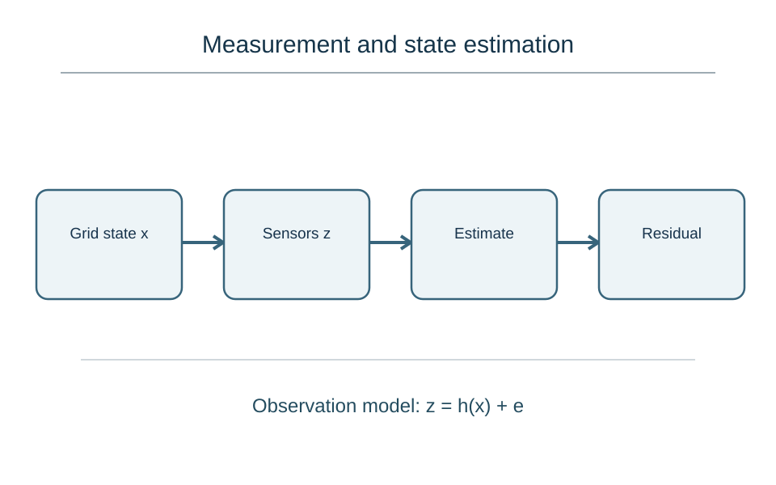

# M6-L1 – Measurements and Grid State Estimation {#L1}

**Course area:** M6 – Digital Grids, Security and Resilience  
**Level:** Bachelor · Advanced/elective profile  
**Prerequisites:** Basic electrical quantities and introductory mathematics.  
**Learning objective:** distinguish measurement model, estimated grid state and residual.

## Motivating problem {#S1}

Network operators cannot infer the full electrical state from one reading. Sensors measure voltage, current, power or switching status at selected points. **State estimation** reconstructs a consistent set of bus states when the measurement layout and model permit it.

## Concepts, Model and Derivation {#S2}

A locally linear measurement model is $\boldsymbol z=H\boldsymbol x+\boldsymbol\varepsilon$, with state vector $\boldsymbol x$, measurement model $H$ and measurement error $\boldsymbol\varepsilon$. With known uncertainty weights, a weighted least-squares estimate may minimise $(\boldsymbol z-H\boldsymbol x)^TW(\boldsymbol z-H\boldsymbol x)$. The relevant states must be **observable**, requiring an appropriate rank condition after a reference is fixed.

Residual tests can reveal inconsistent measurements. A small residual cannot prove authenticity, however. Time synchronisation, topology changes, measurement quality and privacy also matter.

For uncorrelated measurement errors with known variances $\sigma_i^2$, the simple weighted model uses $W=\operatorname{diag}(1/\sigma_i^2)$. Correlated errors instead require the appropriate inverse covariance matrix. A larger count of measurements alone guarantees neither independence nor observability.

## Worked Example {#S3}

Three hypothetical sensors measure the same constant voltage as $229$, $230$ and $231\,\mathrm V$ with equal assumed precision. Their least-squares mean is $\hat U=(229+230+231)/3=230\,\mathrm V$ with residuals $-1$, $0$ and $+1\,\mathrm V$. More measurements or a physical multi-bus model could modify the estimate.

### Further study 1

For three independent unbiased measurements of the same constant voltage with known standard deviations $\sigma_i$, minimise $J(u)=\sum_i(z_i-u)^2/\sigma_i^2$. Setting $\mathrm dJ/\mathrm du=0$ yields $\hat u=\sum_iw_i z_i/\sum_iw_i$ with $w_i=1/\sigma_i^2$. Under these assumptions the estimator is unbiased and its variance is $1/\sum_iw_i$. For $z=(229,230,235)$ V and $\sigma=(1,1,5)$ V, the unweighted mean is 231.333 V and the weighted estimate is 229.608 V. Its standard deviation is approximately 0.700 V. The third reading is downweighted, not rejected on that basis alone. Residuals $z_i-\hat u$ are approximately −0.608 V, +0.392 V and +5.392 V.

An actual network state estimator replaces $u$ with a state vector (e.g. bus voltage angles and magnitudes) and the direct measurement equation with a generally nonlinear function $h(x)$. Correlated errors require a suitable covariance matrix instead of independent weights. A small objective value does not prove that the topology or measurements are correct.

## Self-Check {#S4}

### Exercises

1. If one of three equal-weight readings jumps to 260 V while the others remain 229 and 230 V, what is the new mean and a suitable next quality check?
2. Two equally weighted sensors of the same quantity report 98 and 102 units. Find the estimate and both residuals (measurement minus estimate).
3. What is the estimate if all three standard deviations are equal?
4. Why is a small estimator variance alone insufficient to prove measurement correctness?

::: {.lc-solutions data-lc-section="S4"}
1. $(229+230+260)/3\approx239.67\,\mathrm V$. The mean is distorted by the outlier. Inspect residuals, sensor status and possibly robust estimation rather than automatically declaring a sensor faulty.
2. 100; −2 and +2. A shared offset would not be detected this way.
3. Equal weights give the arithmetic mean of 231.333 V.
4. The variance holds only under the assumed error model. Shared systematic errors, correlations or a wrong model can bias the estimate.
:::

## Assumptions, Safety and Limits {#S5}

A simple mean is not a full network state estimator. Observability, nonlinear measurement functions, authenticity and operational deployment need further engineering validation.

## Summary and Next Steps {#S6}

State estimation tests measurement-model consistency but does not itself verify physical truth. Data provenance and IT/OT safeguards complement it.

**Continue:** [M6-L2 – Digital Grids and Communication Risks](M6-L2.md).

## Sources (external) {#S7}

- [KIT, Institut für Elektroenergiesysteme und Hochspannungstechnik – Elektrische Energienetze](https://www.ieh.kit.edu/2448_bee.php) · EEN lecture contents (winter semester), sections 1–5; three-phase power, power flow, networks and faults · Last accessed: 2026-11-23
- [Universität Stuttgart, Fakultät 5 – Electrical Power Systems](https://www.f05.uni-stuttgart.de/ei/studiengaenge/eeng/uebersicht/Electrical-Power-Systems/) · Electrical Power Systems degree specialisation; generation, distribution, sustainable and reliable networks · Last accessed: 2026-11-23
- [pandapower – State Estimation](https://pandapower.readthedocs.io/en/stable/estimation.html) · Theoretical Background; measurement uncertainty and state estimation · Last accessed: 2026-11-24
