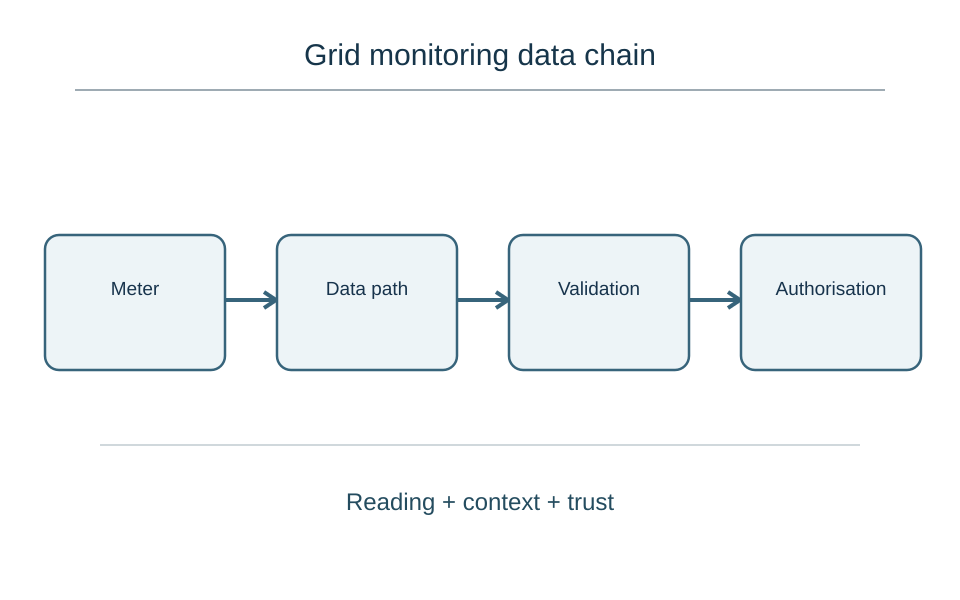

# M6-L2 – Digital Grids and Communication Risks {#L2}

**Course area:** M6 – Digital Grids, Security and Resilience  
**Level:** Bachelor · Advanced/elective profile  
**Prerequisites:** Basic electrical quantities and introductory mathematics.  
**Learning objective:** assess measurement data for time context, units, provenance and trustworthiness.

## Motivating problem {#S1}

Digital grid operation links sensors, communications, state estimation and operational decisions. This improves visibility and control but creates dependencies on clocks, software, networks and identity management. A reading is meaningful only when its **time, units, provenance and quality** are known.

## Concepts, Model and Derivation {#S2}

A defensible conceptual data chain has (1) a sensor with known range; (2) timestamping and local processing; (3) authenticated transmission across separated network zones; (4) data validation and a state model; and (5) authorised display and action. Plausible numerical values alone do not prove trustworthiness. Keep monitoring, planning and live control explicitly separate.

Even a mathematically correct controller may react incorrectly when fed bad inputs. Controls include limited access, multi-person approval where appropriate, change logs, reliable timing, redundant sources and a safe fallback state. Specific implementations must follow applicable industrial-control security requirements; this lesson does not provide attack or bypass instructions.

## Worked Example {#S3}

A monitor reports 4.0 MW but its timestamp is 20 minutes old. Another reports 6.0 MW now. They must not simply be summed for a present-time system balance. First compare timestamps, measurement intervals and units. The older value may remain useful for historic analysis, not for a current state estimate.

## Self-Check {#S4}

### Exercises

1. Name three metadata fields needed before incorporating a power reading into a grid balance. Why is a valid timestamp alone insufficient?
2. One reading is 2 MW averaged over 15 minutes; another is 2 MWh over the same interval. Are they equivalent?

::: {.lc-solutions data-lc-section="S4"}
1. At minimum measurement point, unit and measurement instant or interval; sign/direction and quality are also needed. A timestamp does not establish authenticity, calibration or correct topology.
2. No. 2 MW over 15 min = 0.5 MWh; 2 MWh corresponds to an 8 MW average.
:::

## Assumptions, Safety and Limits {#S5}

General defensive principles do not replace a current sector-specific security assessment. Live grid control is strictly for authorised operators.

For contemporary context, the International Energy Agency report *Modernising Grids in the Age of Electricity* (**21 September 2026**) discusses how digital grid tools can support situational awareness, forecasting, optimisation and risk management. This high-level assessment is neither certification of a particular system nor proof of data security.

## Summary and Next Steps {#S6}

Correct control algorithms need valid and trustworthy data. Common-cause failures still matter even in redundant systems.

**Continue:** [M6-L3 – Reliability and Resilience](M6-L3.md).

## Sources (external) {#S7}

- [Universität Stuttgart, Fakultät 5 – Electrical Power Systems](https://www.f05.uni-stuttgart.de/ei/studiengaenge/eeng/uebersicht/Electrical-Power-Systems/) · Electrical Power Systems degree specialisation; generation, distribution, sustainable and reliable networks · Last accessed: 2026-11-23
- [TU Dresden, Fakultät Elektrotechnik und Informationstechnik – Wahlpflichtmodule ET, MT, IST, RES](https://tu-dresden.de/ing/elektrotechnik/studium/im_studium/lehrangebot/wahlpflichtmodule) · Planning of Electrical Power Systems / Fundamentals of Electrical Power Systems / Controlled Power Systems; network planning, calculations, equipment and control · Last accessed: 2026-11-23
- [IEA – Modernising Grids in the Age of Electricity (21 September 2026)](https://www.iea.org/reports/modernising-grids-in-the-age-of-electricity) · Digital technologies, grid optimisation, monitoring and risk management; report overview · Web view checked: 2026-11-23
