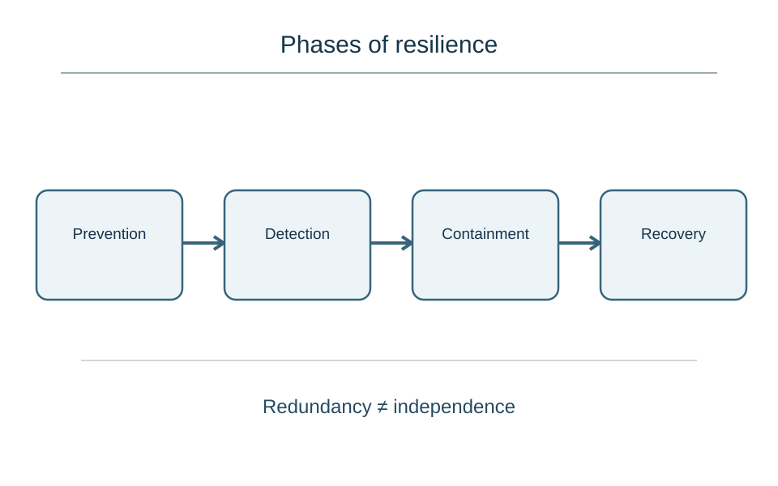

# M6-L3 – Reliability and Resilience {#L3}

**Course area:** M6 – Digital Grids, Security and Resilience  
**Level:** Bachelor · Advanced/elective profile  
**Prerequisites:** Basic electrical quantities and introductory mathematics.  
**Learning objective:** evaluate resilience measures and common-cause failures for a supply path.

## Motivating problem {#S1}

Reliability asks whether electricity can be delivered under expected conditions; resilience adds the ability to endure and recover from major disruptions. Both depend on technology, organisation and critical dependencies. Two redundant lines are not independent if both share the same vulnerable corridor.

## Concepts, Model and Derivation {#S2}

A useful resilience cycle consists of prevention, preparation, detection, containment, recovery and learning. First identify critical services rather than merely counting components: electricity is needed for cooling, communications, pumping and sometimes for the grid infrastructure itself. Then analyse failure paths, backup resources and restoration prerequisites.

Redundancy does not imply independence. Similar systems can fail from the same common cause. Islanded operation requires appropriate local voltage/frequency control and protection; disconnecting a feeder is insufficient. Restoration is a planned operational process, not an improvised switch sequence.

## Worked Example {#S3}

A hypothetical data centre has two power feeds through separate transformers, but both cables share a single underground duct. It has redundancy against one transformer failure but not against duct damage. A more resilient design would investigate route diversity and cooling and communications dependencies. No quantitative reliability improvement can be claimed without failure data.

### Further study 1

**Learning objective:** Calculate shortage probability and expected unserved energy from discrete scenarios.

Resource adequacy examines whether available generation, storage, imports and flexible demand can satisfy demand under assumed scenarios. It differs from operational stability, local distribution reliability and restoration capability after disturbances. ENTSO-E uses, among other indicators, loss of load expectation (LOLE), the expected duration of shortages, and expected energy not served (EENS).

For discrete scenarios $s$ with probabilities $p_s$ and time steps $t$ of duration $\Delta t$, let $u_{s,t}=\max(0,D_{s,t}-A_{s,t})$ denote unmet power demand. In the teaching model, $\mathrm{LOLE}=\sum_s p_s\sum_t \mathbf{1}_{u_{s,t}>0}\Delta t$ and $\mathrm{EENS}=\sum_s p_s\sum_t u_{s,t}\Delta t$. D and A are in MW, LOLE in hours and EENS in MWh for the period considered.

Consider three hours, each with a demand of 100 MW. Available power is as follows:

| Scenario | Probability | Hour 1 | Hour 2 | Hour 3 | Shortage duration | Unserved energy |
|---|---:|---:|---:|---:|---:|---:|
| A | 0.70 | 110 | 105 | 105 | 0 h | 0 MWh |
| B | 0.20 | 90 | 95 | 105 | 2 h | 15 MWh |
| C | 0.10 | 100 | 80 | 90 | 2 h | 30 MWh |

LOLE = 0.6 h and EENS = 6 MWh per modelled three-hour period. An additional resource that is continuously available at 10 MW eliminates the shortage in B and reduces C to 10 MW in hour 2. Then LOLE is 0.1 h and EENS is 1 MWh. The model assumes the resource can provide full power throughout all hours; storage would require an additional energy balance.

The 0.6 h is an expected value over scenarios, not a predicted household interruption duration. The three-hour calculation cannot be extrapolated to a year without temporal representativeness. Actual adequacy studies model spatial interconnections, weather correlations, outages and temporal flexibility limits.

## Self-Check {#S4}

### Exercises

1. Why does a second power line over the same bridge as the first offer incomplete risk reduction?
2. Two independent lines share one power supply for communication equipment. Identify a common failure mechanism and a measure to assess.
3. What is the probability of at least one shortage hour?
4. What are LOLE and EENS with an additional continuously available 5 MW?
5. Why is specifying a 10 MW battery insufficient?

::: {.lc-solutions data-lc-section="S4"}
1. One common-cause event damaging or closing that bridge can affect both lines. Resilience assessment must evaluate correlated failures.
2. Shared auxiliary power failure can affect both communications paths; assess independent auxiliary supplies and behaviour during communication loss.
3. 0.3 before adding the resource.
4. 0.4 h and 3 MWh.
5. Without energy capacity, state of charge, efficiency and temporal availability, its deliverable power over multiple hours is unknown.
:::

## Assumptions, Safety and Limits {#S5}

This is qualitative risk reasoning, not an estimate of specific grid reliability or disclosure of real vulnerabilities. Actual restoration procedures belong to competent operators.

## Summary and Next Steps {#S6}

Resilience spans preparedness, containment, recovery and learning; a second line does not necessarily provide independence. Planning compares such risks with grid limits.

**Continue:** [M7-L1 – Grid Planning and the N-1 Principle](M7-L1.md).

## Sources (external) {#S7}

- [Universität Stuttgart, Fakultät 5 – Electrical Power Systems](https://www.f05.uni-stuttgart.de/ei/studiengaenge/eeng/uebersicht/Electrical-Power-Systems/) · Electrical Power Systems degree specialisation; generation, distribution, sustainable and reliable networks · Last accessed: 2026-11-23
- [TU Dresden, Fakultät Elektrotechnik und Informationstechnik – Wahlpflichtmodule ET, MT, IST, RES](https://tu-dresden.de/ing/elektrotechnik/studium/im_studium/lehrangebot/wahlpflichtmodule) · Planning of Electrical Power Systems / Fundamentals of Electrical Power Systems / Controlled Power Systems; network planning, calculations, equipment and control · Last accessed: 2026-11-23
- [ENTSO-E – ERAA 2025](https://www.entsoe.eu/eraa/2025/) · Adequacy findings; probabilistic resource adequacy · Last accessed: 2026-11-24
