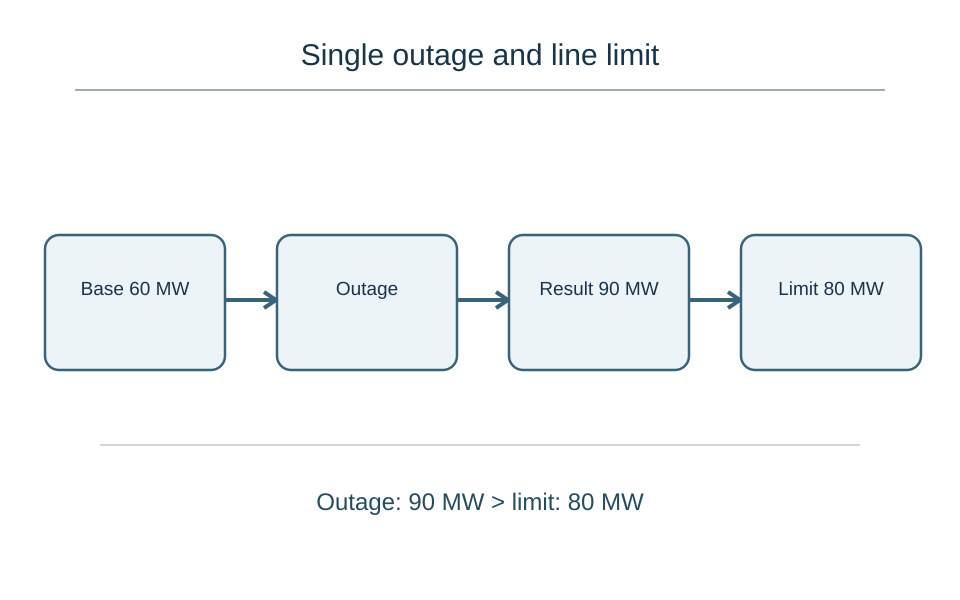

# M7-L1 – Grid Planning and the N-1 Principle {#L1}

**Course area:** M7 – Planning, Markets and System Assessment  
**Level:** Bachelor · Advanced/elective profile  
**Prerequisites:** Basic electrical quantities and introductory mathematics.  
**Learning objective:** check a simple N-1 scenario against an assumed line limit.

## Motivating problem {#S1}

Grid planning must consider changed operating conditions: higher demand, different generation and line outages. The **N-1 principle** examines whether the selected system can satisfy defined requirements after the loss of one specified component. The exact component set and acceptance criteria are not determined by that shorthand alone.

## Concepts, Model and Derivation {#S2}

For a set of credible contingencies $c$, check power flows and limits such as $|P_{\ell,c}|\le P_{\ell,\mathrm{max},c}$ as well as voltages and sometimes dynamic criteria. Passing N-1 does not imply surviving every combination of multiple simultaneous failures. Planning options include additional capacity, network reinforcement, flexibility and approved operational remedies.

Sensitivity models can screen contingency cases, but a complete assessment may need AC load flow and dynamic studies. Environmental and economic implications, lead time and critical load requirements also matter.

## Worked Example {#S3}

A line carries $60\,\mathrm{MW}$ in the base case. In a hypothetical outage of a parallel line, it would carry $90\,\mathrm{MW}$ against an assumed $80\,\mathrm{MW}$ limit. The modeled contingency exceeds the limit by 10 MW, equal to 12.5% of its rating. Reinforcement, rerouting or approved operating measures would require assessment.

### Further study 1

Set a hypothetical 70 MW active-power limit in either direction for every branch in M4-L2. The base case (40/50/10 MW) satisfies the limits. With unchanged injections, evaluate the three single outages:

| Availability | A→B (MW) | A→C (MW) | B→C (MW) | Largest limit violation |
|---|---:|---:|---:|---:|
| All branches | 40 | 50 | 10 | 0 MW |
| A–B out | – | 90 | −30 | 20 MW |
| A–C out | 90 | – | 60 | 20 MW |
| B–C out | 30 | 60 | – | 0 MW |

A negative value denotes flow against the indicated direction. Despite connectivity and balanced aggregate injections, two contingencies violate model limits. As a purely hypothetical preventive measure, dispatchable generation at C takes over 20 MW of A's injection. New net injections are A +70, B −30 and C −40 MW. Base-case flows are 33⅓, 36⅔ and 3⅓ MW; for the A–B or A–C outage, the remaining branch leaving A carries 70 MW. For loss of B–C the flows are 30 and 40 MW. All three model contingencies meet the active-power limit. This is not a practical N-1 compliance demonstration: real limits depend on apparent power, voltage, dynamics, switching state, generation availability and applicable rules, among other factors.

## Self-Check {#S4}

### Exercises

1. Does equality of total generation and demand after a line outage prove N-1 compliance?
2. A fictitious branch carries 84 MW after a single contingency; assumed limit is 70 MW. Find absolute and relative exceedance.
3. Why is aggregate balance insufficient for a contingency check?
4. Why must at least 20 MW be shifted from A to C in the preventive model?

::: {.lc-solutions data-lc-section="S4"}
1. No. Remaining individual lines may be overloaded or voltage constraints violated despite balanced total generation and consumption.
2. 14 MW; 20% relative to the limit.
3. The sum remains zero, but remaining branches may exceed their limits.
4. After loss of either branch leaving A, the other must carry A's total injection. Thus $90-g_C\le70$ MW, so $g_C\ge20$ MW. The remaining branch limits were checked separately.
:::

## Assumptions, Safety and Limits {#S5}

The lesson does not prescribe national N-1 exceptions, contingency lists or ratings. Real engineering must use current operator-specific criteria.

## Summary and Next Steps {#S6}

N-1 assesses individual assumed contingencies and remaining network limits, not every multiple outage. Grid planning also considers market and dispatch conditions.

**Continue:** [M7-L2 – Electricity Economics and Congestion Management](M7-L2.md).

## Sources (external) {#S7}

- [TU Dresden, Fakultät Elektrotechnik und Informationstechnik – Wahlpflichtmodule ET, MT, IST, RES](https://tu-dresden.de/ing/elektrotechnik/studium/im_studium/lehrangebot/wahlpflichtmodule) · Planning of Electrical Power Systems / Fundamentals of Electrical Power Systems / Controlled Power Systems; network planning, calculations, equipment and control · Last accessed: 2026-11-23
- [KIT, Institut für Elektroenergiesysteme und Hochspannungstechnik – Elektrische Energienetze](https://www.ieh.kit.edu/2448_bee.php) · EEN lecture contents (winter semester), sections 1–5; three-phase power, power flow, networks and faults · Last accessed: 2026-11-23
- [University of Stuttgart – Examination regulations No. 36/2025](https://www.uni-stuttgart.de/universitaet/aktuelles/bekanntmachungen/Amtliche-Bekanntmachung-Nummer-36-2025/) · Annex 2, section 5(2)(a), grid/renewables modules in the selected BSc elective area · Web view checked: 2026-11-23
- [MATPOWER – DC Power Flow](https://matpower.app/manual/matpower/DCPowerFlow.html) · § 4.2; reduced bus matrix and branch flows · Last accessed: 2026-11-24
