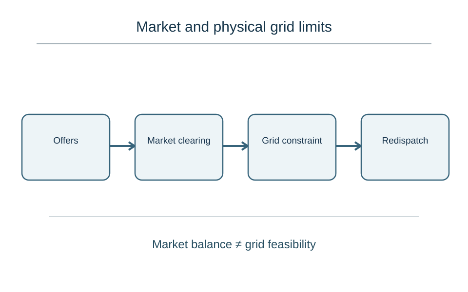

# M7-L2 – Electricity Economics and Congestion Management {#L2}

**Course area:** M7 – Planning, Markets and System Assessment  
**Level:** Bachelor · Advanced/elective profile  
**Prerequisites:** Basic electrical quantities and introductory mathematics.  
**Learning objective:** distinguish offered bid values, marginal price, modelled payments and actual generation costs.

## Motivating problem {#S1}

Electricity markets coordinate commercial supply and demand, while the physical grid constrains whether the resulting injections can be transmitted. A simplified market clearing problem and network congestion management are distinct analytical tasks.

## Concepts, Model and Derivation {#S2}

A simplified hourly merit-order model ranks generation bids by their **offered prices** and accepts enough energy to meet the modelled demand. A bid price may reflect short-run marginal generation costs but **does not necessarily equal an operator’s actual costs**. For discrete blocks, $C_\mathrm{bid}=\sum_i p_iE_i$ is the **sum of accepted bid values**, with bid price $p_i$ and accepted energy $E_i$; it is neither automatically a statement of production cost nor a record of actual exchange settlement.

Only under the additional assumption of a uniform marginal clearing price $p_\mathrm{marg}$ may the modelled payment to accepted suppliers be $R_\mathrm{model}=p_\mathrm{marg}\sum_iE_i$. Marginal price, bid-weighted mean, actual marginal cost and real-world payments are **four distinct quantities**. Other market designs, fees and contracts are not represented.

Market schedules may overload a physical network corridor, requiring redispatch or other approved responses. Actual roles, network tariffs and payments depend on current jurisdiction-specific market rules; this course does not assert a present legal market design.

## Worked Example {#S3}

A **fully fictional** market needs constant demand of $60\,\mathrm{MW}$ for one hour. Generator A offers $40\,\mathrm{MW}$ at $30\,\mathrm{EUR/MWh}$ and B another $20\,\mathrm{MW}$ at $70\,\mathrm{EUR/MWh}$. Over the hour, the accepted amounts are 40 and 20 MWh. The **sum of accepted bid values** is $C_\mathrm{bid}=40\cdot30+20\cdot70=2600\,\mathrm{EUR}$; the bid-weighted mean is $2600/60\approx43.33\,\mathrm{EUR/MWh}$. The last accepted bid is $70\,\mathrm{EUR/MWh}$. **Only under the additional assumption** that all accepted $60\,\mathrm{MWh}$ receive this uniform price would the modelled payment be $R_\mathrm{model}=60\cdot70=4200\,\mathrm{EUR}$. The difference of $1600\,\mathrm{EUR}$ is **not** evidence of a generator's profit. Actual production costs and real exchange settlements are not provided.

## Self-Check {#S4}

### Exercises

1. Why is it incorrect to infer that every generated MWh cost its producer €70 simply because the marginal offer was €70/MWh?
2. In a fictitious one-hour uniform-price model, bids of 20 MW at EUR 40/MWh and 10 MW at EUR 70/MWh are accepted. Find summed bid values and model payment.

::: {.lc-solutions data-lc-section="S4"}
1. The model's marginal price is the last accepted bid. The bid-weighted mean is €43.33/MWh, but it must **not** be presented as the producers' verified average cost. Actual costs, revenues and contractual payments need separate evidence.
2. 800+700=EUR 1500; 30×70=EUR 2100. The difference is not proven profit.
:::

## Assumptions, Safety and Limits {#S5}

The toy market excludes networks, unit commitment, storage, taxes and actual market design. Uniform pricing here is **an explicit classroom assumption**, not a claim about currently applicable settlement rules. Prices and regulations change; the example is not a market forecast.

## Summary and Next Steps {#S6}

Market clearing and physical grid feasibility are distinct conditions. System-level project comparisons require additional effects and system boundaries.

**Continue:** [M7-L3 – System Comparison and Integrated Case Study](M7-L3.md).

## Sources (external) {#S7}

- [Bundesnetzagentur – Redispatch](https://www.bundesnetzagentur.de/DE/Fachthemen/ElektrizitaetundGas/Versorgungssicherheit/Netzengpassmanagement/Engpassmanagement/Redispatch/artikel.html) · Redispatch introduction and sections; grid congestion, generation adjustments and reactive power · Last accessed: 2026-11-23
- [Universität Stuttgart, Fakultät 5 – Electrical Power Systems](https://www.f05.uni-stuttgart.de/ei/studiengaenge/eeng/uebersicht/Electrical-Power-Systems/) · Electrical Power Systems degree specialisation; generation, distribution, sustainable and reliable networks · Last accessed: 2026-11-23
- [Bundesnetzagentur/SMARD – This is how the electricity market works](https://www.smard.de/page/en/wiki-article/5884/5840/this-is-how-the-electricity-market-works) · Section “Lower-priced generation has priority”; merit-order offers, typical marginal costs and simplified marginal pricing; not a universal settlement promise · Web view checked: 2026-11-23
