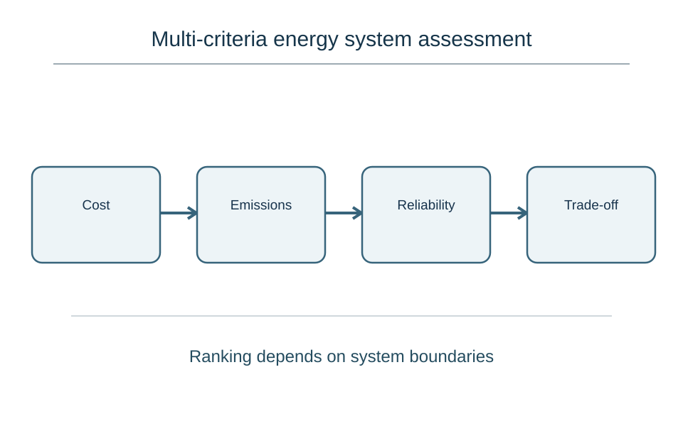

# M7-L3 – System Comparison and Integrated Case Study {#L3}

**Course area:** M7 – Planning, Markets and System Assessment  
**Level:** Bachelor · Advanced/elective profile  
**Prerequisites:** Basic electrical quantities and introductory mathematics.  
**Learning objective:** calculate simplified levelised energy cost and critically assess multi-criteria evaluations.

## Motivating problem {#S1}

Energy systems have competing goals: cost, environmental impact, security of supply, flexibility and social acceptance. A sound comparison makes the **system boundary, time horizon, scenario, data date and uncertainty** explicit rather than presenting one supposedly objective score.

## Concepts, Model and Derivation {#S2}

An extremely simplified cost metric is $LCOE=C_\mathrm{annual}/E_\mathrm{annual}$ when costs are correctly annualised and energy output is measured over the same period. Full models account for capital, operation, fuel, residual value and system integration. CO₂ assessment requires a clear life-cycle boundary and sourced emission factors. Availability and security of supply cannot be assessed by €/MWh or emissions alone.

A multi-criteria matrix compares options on cost, emissions, system value and risks. Weights must be disclosed because alternative choices may reverse rankings. Stress tests with changing wind and load profiles are more informative than a single favourable scenario.

The annual-cost quotient is interpretable as a simplified LCOE comparison only when both annual costs have **already been annualised on a consistent economic basis** and costs and energy cover the same system boundary. A full project LCOE otherwise calls for a consistent life-cycle treatment of discounted costs and electricity generation. Grid value cannot be inferred from the €/MWh figure alone.

## Worked Example {#S3}

Two **hypothetical** projects are compared under a common simplified boundary. Project A costs €3.0 million per year and generates $60\,\mathrm{GWh}$, so $LCOE_A=(3.0\cdot10^6\,\mathrm{EUR})/(60\cdot10^3\,\mathrm{MWh})=50\,\mathrm{EUR/MWh}$. Project B costs €4.2 million and yields $70\,\mathrm{GWh}$, giving $LCOE_B=60\,\mathrm{EUR/MWh}$. A scores better on this metric, but reliability, network and environmental effects are not included.

### Further study 1

Four one-hour intervals: load [4, 6, 7, 5] MW and wind [6, 4, 2, 5] MW. A storage unit has 4 MWh usable capacity, initial energy of 1 MWh, 2 MW charging and discharging limits and 90% efficiency in each direction. Dispatchable reserve covers residual deficits; exports are not allowed. The heuristic charges from excess generation and discharges during deficits subject to available energy. Network losses and self-discharge are neglected.

| Hour | Load | Wind | Charge MW | Discharge MW | End energy MWh | Reserve MW | Curtailment MW |
|---|---:|---:|---:|---:|---:|---:|---:|---:|
| 1 | 4 | 6 | 2 | 0 | 2.8 | 0 | 0 |
| 2 | 6 | 4 | 0 | 2 | 0.57778 | 0 | 0 |
| 3 | 7 | 2 | 0 | 0.52 | 0 | 4.48 | 0 |
| 4 | 5 | 5 | 0 | 0 | 0 | 0 | 0 |

Reserve supplies 4.48 MWh; without storage, 7 MWh of reserve and 2 MWh of curtailment would be required. The final energy differs from the initial energy, so this is not a cyclic daily comparison. Fair optimisation over repeated cycles requires an end-SOC constraint; this heuristic does not establish cost-optimal dispatch.

### Further study 2

Reuse the hypothetical demand/wind data from the v1.0.12 case study: one hour each, demand 4/6/7/5 MW and wind 6/4/2/5 MW, capacity 4 MWh, initial energy 1 MWh, both power limits 2 MW, both efficiencies 0.9. Additionally require $E_4=E_0=1$ MWh, no export, no charging from reserve and no simultaneous charging/discharging. Reserve has no power limit; minimise only total reserve energy without hourly differences in cost or emissions.

Hour 1 provides 2 MWh of surplus. This adds 1.8 MWh to stored energy. With equal initial and final energy, total electrical discharge can therefore only be $1.8\cdot0.9=1.62$ MWh. One feasible schedule is:

| Hour | Charge (MW) | Discharge (MW) | End energy (MWh) | Reserve (MW) | Curtailment (MW) |
|---|---:|---:|---:|---:|---:|
| 1 | 2 | 0 | 2.8 | 0 | 0 |
| 2 | 0 | 1.62 | 1 | 0.38 | 0 |
| 3 | 0 | 0 | 1 | 5 | 0 |
| 4 | 0 | 0 | 1 | 0 | 0 |

Total reserve is 5.38 MWh, compared with 7 MWh without storage. The 1.62 MWh reduction is precisely the usable captured surplus; conversion losses account for 0.38 MWh. Under these specific assumptions the minimum reserve energy is 5.38 MWh: no more than 2 MWh of charging energy is available, and 81% can be returned as cyclic electrical discharge. The time allocation is not unique. An alternative schedule could discharge the same energy in hour 3 and reduce the reserve peak. The non-cyclic variant in v1.0.12 requires 4.48 MWh of reserve but additionally consumes the initial 1 MWh of stored energy (0.9 MWh electrical output). The cases must not be compared as equivalent repeatable cycles.

## Self-Check {#S4}

### Exercises

1. Why might the project with the lower bare generation cost be the inferior choice for an islanded grid?
2. Two hypothetical projects deliver 40 GWh annually; equivalent annual costs are EUR 2.4 and 3.2 million. Compare LCOE and identify one missing comparison criterion.
3. In which interval does energy availability rather than the power rating limit discharge?
4. What is the maximum discharge power in interval three if a minimum energy of 0.2 MWh must be retained?
5. What is the maximum reserve power in the given schedule? How can moving discharge to hour 3 reduce it while preserving reserve energy?
6. Under what additional assumptions would minimising reserve energy be insufficient to determine the economically optimal schedule?

::: {.lc-solutions data-lc-section="S4"}
1. If output is unavailable when needed, additional storage, backup or network costs can dominate. Cost per MWh ignores time-dependent system value and reliability.
2. EUR 60 and 80/MWh; e.g. temporal availability or additional reserve costs.
3. Hour 3: the remaining stored energy delivers only 0.52 MW for one hour.
4. $(0.57778-0.2)\cdot0.9\approx0.34$ MW. Reserve must supply 4.66 MW.
5. Initially 5 MW. Discharging all 1.62 MW in hour 3 requires 3.38 MW of reserve then and 2 MW in hour 2; the peak falls to 3.38 MW. Total reserve remains 5.38 MWh. Since hour 3 alone has a 5 MW deficit and at most 1.62 MWh of cyclic discharge is possible, this is also the smallest achievable reserve peak in this example.
6. For example, varying hourly reserve costs, start-up and ramping costs, storage degradation, network congestion or differing emissions.
:::

## Assumptions, Safety and Limits {#S5}

All values are invented examples. Real capital budgets, life-cycle data and uncertainty assessments are missing. The lesson is not an investment or policy recommendation.

## Summary and Next Steps {#S6}

A cost-per-MWh comparison is meaningful only with matching cost and energy boundaries. Reliability, emissions and grid integration need further transparently weighted criteria.

## Sources (external) {#S7}

- [Universität Stuttgart, Fakultät 5 – Electrical Power Systems](https://www.f05.uni-stuttgart.de/ei/studiengaenge/eeng/uebersicht/Electrical-Power-Systems/) · Electrical Power Systems degree specialisation; generation, distribution, sustainable and reliable networks · Last accessed: 2026-11-23
- [TU Dresden, Fakultät Elektrotechnik und Informationstechnik – Wahlpflichtmodule ET, MT, IST, RES](https://tu-dresden.de/ing/elektrotechnik/studium/im_studium/lehrangebot/wahlpflichtmodule) · Planning of Electrical Power Systems / Fundamentals of Electrical Power Systems / Controlled Power Systems; network planning, calculations, equipment and control · Last accessed: 2026-11-23
- [PyPSA – Storage](https://docs.pypsa.org/latest/user-guide/optimization/storage/) · Storage Units; time-coupled storage balance and cyclic boundary condition · Last accessed: 2026-11-24
